# LactaTwin Decision Core — Dairy Processing Plant Digital Twin
**Partner**: `[Nama Pabrik]`  
**Data Classification**: `DATA SINTETIS` (Seluruh data, metrik, tabel, dan respon API berlabel data sintetis)  
**Versi Core**: `1.0.0`

---

## 1. Ikhtisar Sistem (System Overview)

**LactaTwin Decision Core** adalah mesin analitik prediktif dan optimasi operasional berbasis kecerdasan buatan dan riset operasi (*Operations Research*) untuk pabrik pengolahan susu segar. Sistem ini mengintegrasikan:
1. **Model Prediksi Machine Learning**: Quantile regression LightGBM (P50, P80, P90) dan kalibrasi Isotonic probability untuk mengestimasi waktu tempuh truk tangki (*ETA*), durasi pengujian laboratorium mutu (*QC Release*), serta deteksi anomali volume neraca massa (*Isolation Forest*).
2. **Mesin Optimasi OR-Tools CP-SAT**: Solver berkendala diskret yang menjadwalkan bay penerimaan truk tangki, alokasi tangki silo penyimpanan (*Storage Tanks*), urutan lini pengemasan (*Packaging Lines*), pergantian produk (*Sequence-Dependent Changeovers*), serta siklus pembersihan otomatis (*CIP*).
3. **Simulasi Discrete-Event & Traceability**: Mesin eksekusi SimPy yang memverifikasi rencana terhadap durasi realisasi nyata dan mencatat silsilah batch hulu-ke-hilir (*genealogy ledger*).

---

## 2. Arsitektur Rantai Pengolahan (End-to-End Plant Chain)

```mermaid
flowchart LR
    A["Peternakan (Farm)"] -->|"Truk Tangki (Road Transit)"| B["Gerbang Pabrik (Gate)"]
    B -->|"Sampling"| C["Laboratorium QC"]
    C -->|"Status: RELEASED"| D["Bay Pembongkaran (UB-01..04)"]
    D -->|"Unloading (25.000 L/h)"| E["Tangki Penyimpanan (SFP-01..15)"]
    E -->|"Pasteurisasi Awal"| F["Thermizer (TH-01..02)"]
    F -->|"Sterilisasi UHT/ESL"| G["Sterilizer (ST-01..05)"]
    G -->|"Buffer Aseptik"| H["Tangki Aseptik (AT-01..05)"]
    H -->|"Output Flow <= 18.000 L/h"| I["Lini Pengisian (FL-01..10)"]
    I --> J["Barang Jadi (Finished Goods)"]

    style C fill:#f9f,stroke:#333,stroke-width:2px
    style D fill:#bbf,stroke:#333,stroke-width:2px
    style H fill:#dfd,stroke:#333,stroke-width:2px
    style I fill:#fdd,stroke:#333,stroke-width:2px
```



---

## 3. Delapan Aturan Kunci (The 8 Hard Rules)

* **R1**: **ML Memprediksi, CP-SAT Memutuskan**. Tidak ada model ML atau LLM yang memilih atau mengedit jadwal.
* **R2**: **Konfigurasi Terpusat**. Seluruh parameter pabrik berada di `configs/master.yaml`. Parameter yang belum terkalibrasi ditandai `placeholder: true` dan dicatat di `docs/assumptions.md`.
* **R3**: **Data Sintetis**. Tidak ada data riil pabrik yang digunakan dalam pengujian repositori ini. Seluruh keluaran diberi label `DATA SINTETIS`.
* **R4**: **Validator Independen**. Modul `src/opt/validator.py` sama sekali tidak mengimpor OR-Tools dan mampu memvalidasi jadwal manual maupun otomatis.
* **R5**: **Determinisme Total**. Seed acak tetap (`seed=42`) digunakan di seluruh model dan solver (`num_workers=1`).
* **R6**: **Tidak Ada Relaksasi Diam-diam**. Jika kendala matematis tidak terpenuhi, solver mengembalikan penjelasan diagnostik terstruktur (*minimal conflict set*).
* **R7**: **Evaluasi Realisasi**. Rencana jadwal selalu dievaluasi di dalam simulator dengan durasi realisasi stokastik (*realized durations*), bukan durasi prediksi.
* **R8**: **Pelaporan Transparan & Jujur**. Setiap hasil (positif maupun negatif) dilaporkan apa adanya terhadap baseline.

---

## 4. Struktur Repositori (Repo Layout)

```
lactatwin_decision_core/
├── configs/
│   ├── master.yaml             # Master plant configurations & placeholder flags
│   └── scenarios/              # Stress-test scenarios definitions
├── data/
│   └── synthetic_90d/          # 90-hari log operasional sintetis tervalidasi
├── docs/
│   ├── assumptions.md          # Daftar lengkap placeholder & asumsi generator
│   └── swap_real_data.md       # Panduan integrasi data riil bagi tim pabrik
├── models/
│   └── registry/               # Bobot model ML LightGBM & metadata audit JSON
├── reports/
│   └── eval_sintetis.md        # Laporan komparasi kebijakan 20 seed x 7 skenario
├── scripts/
│   └── run_benchmark.py        # Runner simulasi multi-scenario benchmark
├── src/
│   ├── api/
│   │   └── app.py              # FastAPI REST endpoints
│   ├── data/
│   │   ├── adapter.py          # Data adapter interface untuk CSV riil
│   │   ├── config_loader.py    # MasterConfig loader & placeholder scanner
│   │   └── schemas.py          # Kontrak data Pydantic v2
│   ├── opt/
│   │   ├── brute_force.py      # Combinatorial enumerator exact check (n <= 4)
│   │   ├── core.py             # CP-SAT receiving & bay scheduler
│   │   ├── explain.py          # Explainer & minimal conflict set engine
│   │   ├── policies.py         # Kebijakan B0 (FIFO), B1 (Fixed), B2..B4
│   │   ├── prod.py             # CP-SAT packaging lines & setup scheduler
│   │   ├── replan.py           # Predict-then-optimize replanner & Monte Carlo
│   │   ├── validator.py        # Independent schedule validator (R4)
│   │   └── whatif.py           # What-if scenario sensitivity engine
│   ├── predict/
│   │   ├── features.py         # Zero-leakage temporal feature extraction
│   │   ├── metrics.py          # Pinball loss, ECE, PSI, Bootstrap 95% CI
│   │   ├── models.py           # LightGBM Quantile Regressor & Anomaly Detector
│   │   ├── registry.py         # Persistence & fallback inference service
│   │   └── train.py            # Training pipeline 60/20/20 walk-forward CV
│   ├── sim/
│   │   ├── engine.py           # SimPy discrete-event simulator & ledger
│   │   └── generator.py        # 90+ days continuous synthetic generator
│   └── trace/
│       └── genealogy.py        # Forward & backward milk batch traceability
└── tests/
    ├── test_phase0.py          # Specs & contracts tests
    ├── test_phase1.py          # Simulator & mass balance tests
    ├── test_phase2.py          # Prediction models & drift tests
    ├── test_phase3.py          # Receiving CP-SAT core & brute force tests
    ├── test_phase4.py          # Production sequencing & setup benchmark tests
    ├── test_phase5.py          # Replanning triggers, explain, whatif & trace tests
    └── test_phase6.py          # FastAPI REST endpoints suite tests
```

---

## 5. Instalasi dan Persiapan Lingkungan

Sistem membutuhkan **Python 3.11+** dan pengelola paket modern seperti `uv`:

```bash
# 1. Clone repositori & masuk ke direktori kerja
cd lactatwin_decision_core

# 2. Buat virtual environment dengan Python 3.11
uv venv --python 3.11 .venv

# 3. Aktifkan virtual environment
source .venv/bin/activate

# 4. Instal seluruh dependensi
uv pip install -r <(echo "
pandas>=2.2.0
scikit-learn>=1.4.0
lightgbm>=4.3.0
simpy>=4.1.0
pydantic>=2.6.0
fastapi>=0.110.0
pytest>=8.0.0
ortools>=9.9.0
httpx>=0.27.0
")
```

---

## 6. Menjalankan Pengujian (Testing)

Jalankan seluruh rangkaian pengujian dari Phase 0 hingga Phase 6:

```bash
# Menjalankan seluruh test suite (27+ test cases)
PYTHONPATH=. .venv/bin/pytest -v tests/
```

Jalankan suite benchmark 20 seed untuk menghasilkan laporan komparasi kebijakan:

```bash
PYTHONPATH=. .venv/bin/python scripts/run_benchmark.py
```
Laporan akan otomatis tersimpan di [`reports/eval_sintetis.md`](reports/eval_sintetis.md).

---

## 7. Menjalankan REST API Service

Jalankan server FastAPI lokal:

```bash
PYTHONPATH=. .venv/bin/python -m uvicorn src.api.app:app --host 0.0.0.0 --port 8000 --reload
```

Dokumentasi interaktif OpenAPI / Swagger dapat diakses di:
`http://localhost:8000/docs`

### Ringkasan Endpoint API
| Metode | Endpoint | Deskripsi |
| :--- | :--- | :--- |
| `POST` | `/predict/eta` | Prediksi kuantil durasi perjalanan armada (P50, P80, P90) |
| `POST` | `/predict/lab` | Prediksi kuantil durasi uji laboratorium mutu QC |
| `POST` | `/plan` | Generate jadwal operasional optimal harian (Receiving & Filling) |
| `POST` | `/replan` | Penjadwalan ulang dinamis berbasis *event triggers* & *frozen window* |
| `POST` | `/whatif` | Simulasi skenario hipotesis dengan delta KPI instan |
| `GET` | `/explain/{schedule_id}` | Penjelasan terstruktur: alasan penugasan, batasan aktif, dan *slack* |
| `GET` | `/trace/forward/{trip_id}` | Penelusuran silsilah susu dari truk tangki ke *finished goods* |
| `GET` | `/trace/backward/{lot_id}` | Penelusuran silsilah mundur dari produk jadi ke peternakan & uji lab |
| `GET` | `/neraca` | Status neraca massa harian dan verifikasi residual volume pabrik |

---

## 8. Batasan Sistem dan Asumsi (Limitations & Assumptions)

1. **Ketiadaan Data Riil**: Saat ini seluruh pengujian menggunakan dataset sintetis yang mencerminkan profil operasional tipikal industri susu (Rule R3). Integrasi data riil dapat dilakukan melalui panduan di [`docs/swap_real_data.md`](docs/swap_real_data.md).
2. **Kerapatan Susu**: Ditetapkan konstan sebesar $1.0\text{ kg/L}$ sesuai asumsi spesifikasi partner.
3. **Faktor Penggunaan Susu (Milk Usage Factor)**:
   - Susu Segar Full Cream & Skim: $100\%$ ($1.0$).
   - Susu Berperisa (Cokelat & Stroberi): $90\%$ ($0.9$).
4. **Hierarki Pergantian Produk (*Changeover Precedence*)**:
   - `VARIANT` ($90\text{ menit}$) mengesampingkan `SIZE` dan `PAPER`.
   - `SIZE` ($60\text{ menit}$) tidak menambahkan waktu `PAPER`.
   - `PAPER` ($20\text{ menit}$) hanya berlaku jika ukuran dan varian cairan sama.
   - Siklus pencucian tangki (*CIP*) berjalan independen dari setup mekanik.
5. **Daftar Lengkap Placeholder**: Seluruh 25+ parameter pabrik yang berstatus placeholder didokumentasikan di [`docs/assumptions.md`](docs/assumptions.md).
