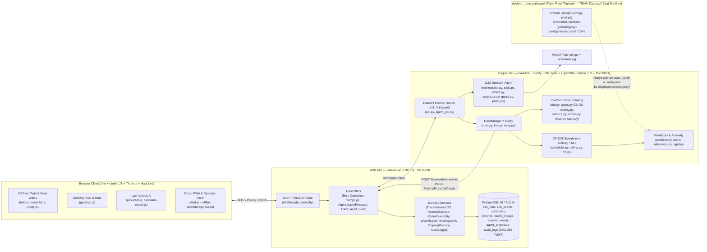

# Laporan Review & Strategi Peningkatan LactaTwin (`[Nama Pabrik]`)

**Kompetisi:** PLAY IT! PLUS Hackathon Deeptech — Studi Kasus Produsen Susu (`[Nama Pabrik]`)  
**Klasifikasi Data:** `DATA SINTETIS` (Seluruh angka operasional berasal dari simulator *discrete-event* dan generator sintetis; klaim kematangan teknologi dibatasi pada **TRL 2–3**)  
**Peran Reviewer:** Principal Engineer + Product Strategist + Hackathon Judge  
**Mode Audit:** *Read-and-Measure* (R1–R7 dipatuhi penuh; tidak ada kode, konfigurasi, atau data produksi yang diubah)

---

## 0. Asumsi eksplisit atas input pengguna yang belum diisi

Karena bagian `INPUTS FROM ME` pada prompt masih berisi placeholder (`[ISI: ...]`), review ini menyatakan asumsi eksplisit berikut dan memvalidasinya kembali pada Bagian 9:

| Parameter Input | Asumsi Kerja yang Digunakan | Rasional |
|---|---|---|
| **Waktu tersisa hingga demo/submisi** | **9 hari kerja** (dengan cadangan *buffer* 30% = ~2,7 hari untuk pembekuan kode, latihan demo, dan perbaikan bug akhir; menyisakan **~6 hari kerja efektif** atau **~24 *person-days***). | Sesuai contoh pada prompt dan proporsional untuk mengeksekusi *Quick Wins* + perbaikan struktural teratas tanpa merusak stabilitas. |
| **Ukuran & keahlian tim** | **4 orang**: 2 Backend/ML/Optimization (`engine/`, `decision_core_package/`), 1 Frontend/Web (`web/resources/js/`, Blade, Three.js), 1 Product/UI/Proposal (`docs/`, skrip demo, materi juri). | Memungkinkan paralelisasi antara perbaikan CP-SAT/SimPy di Python dan pemolesan Laravel/Three.js di Web. |
| **Kriteria penilaian penyelenggara** | Bobot seimbang: **(1) Kesesuaian Masalah & Constraint Operasional Mitra (30%)**, **(2) Kedalaman Teknis AI + Optimasi + Digital Twin (25%)**, **(3) Dampak Bisnis & Bukti Kuantitatif/KPI (20%)**, **(4) Kesiapan Implementasi, Keamanan & UX Operasional (15%)**, **(5) Kualitas Presentasi & Kejujuran Ilmiah (10%)**. | Standar penjurian *deeptech corporate challenge* dengan mitra industri manufaktur. |
| **Permintaan mentor/dosen** | Prototipe harus selaras dengan bagan **Operational Constraint** mitra (`[Nama Pabrik]`): rantai penerimaan $\rightarrow$ 15 tangki penyimpanan $\rightarrow$ *thermizer* $\rightarrow$ *SFP storage* $\rightarrow$ *sterilizer* $\rightarrow$ *aseptic tank* $\rightarrow$ *filling line*, aturan CIP & *changeover*, *traceability* campuran/pecahan (*mixing/splitting*), serta *closed-loop re-test*. | Menjadi tolok ukur utama pada Fase 1 (Matriks Cakupan Brief). |
| **Titik terlemah tim saat ini** | **Diskoneksi antara dua kodebasis** (`engine/` vs `decision_core_package/`) dan **kontradiksi bukti evaluasi kuantitatif** di laporan ablasi/sintetis yang berisiko ditemukan juri saat tanya-jawab. | Terbukti secara terukur pada Fase 2 dan Fase 3 di bawah. |
| **Format demo** | **Live Web Demo 5 menit + 5–10 menit Tanya Jawab Juri** pada resolusi proyektor `1440×900` / `1920×1080`, dengan cadangan *offline replay* deterministik. | Menuntut latensi solver < 2 detik, alur klik tanpa gagal, dan kesiapan menjawab 20 pertanyaan sulit juri. |

---

## 1. Ringkasan Eksekutif (Executive Summary)

### Kondisi Saat Ini (Satu Halaman)
LactaTwin adalah salah satu prototipe *digital twin* manufaktur paling matang secara rekayasa perangkat lunak di tingkat hackathon (TRL 2–3): memiliki simulasi *discrete-event* SimPy yang deterministik (`engine/app/sim.py`), penjadwal OR-Tools CP-SAT (`engine/app/scheduler.py`), model prediksi kuantil LightGBM (`engine/app/predictor.py` & `engine/app/ml/service.py`), *Operator Agent* berbasis LLM dengan *numeric grounding validator* dan *human-in-the-loop proposal* (`engine/app/agent/guard.py`, `web/app/Services/ProposalService.php`), rantai hash audit SHA-256 (`web/app/Services/AuditLogger.php`), serta visualisasi pabrik 3D Three.js + peta kedatangan truk MapLibre (`web/resources/js/twin/scene3d.js`, `geomap.js`).

**Namun, dari kacamata Principal Engineer dan Juri Hackathon, terdapat 3 kerentanan fatal di balik layar:**
1. **Skizofrenia Arsitektur (`engine/` vs `decision_core_package/`):** Seluruh aturan domain yang sesuai dengan brief mitra (`15 SFP storage tanks ST-01..ST-15`, aturan *changeover* hierarkis `VARIANT 90m > SIZE 60m > PAPER 20m`, pemicu CIP *flavour change* `Chocolate/Strawberry -> Full Cream`, densitas `1,0 kg/L`, dan penjadwalan order produksi dinamis) berada di folder terpisah `decision_core_package/` yang **sama sekali tidak dipanggil saat runtime oleh aplikasi web** (`docs/assumptions.md:9`). Sebaliknya, aplikasi web memakai `engine/app/` yang membalik jumlah tangki (**15 tangki bahan baku `TK-RAW-1..15` dan hanya 6 tangki penyimpanan `TK-STO-1..6`** di `engine/app/plant.py:58,64`), menjumlahkan *changeover* secara aditif tanpa *paper change* (`engine/app/plant.py:33-40`), mengevaluasi order produksi secara *post-hoc* (tidak menggerakkan jadwal, `engine/app/orders.py:1-4`), dan menggunakan densitas `1,03 kg/L` di UI (`web/app/Support/Volume.php:8`).
2. **Bukti Kuantitatif yang Menyerang Klaim Sendiri (`docs/ablation-fase4.md` & `decision_core_package/reports/eval_sintetis.md`):**
   - Di `decision_core_package/reports/eval_sintetis.md:23-27`, tabel hasil 700 simulasi menunjukkan kebijakan unggulan **B4 (CP-SAT P80)** menghasilkan waktu tunggu rata-rata **35,80 menit**—**lebih buruk +7,79 menit (-27,8%) dibandingkan baseline B0 (FIFO: 28,00 menit)**, dan 4 skenario gangguan (`cip_overrun`, `tank_unavailable`, `maintenance_window`, `rush_order` pada baris 43–46) memiliki angka yang **100% identik dengan `normal_day` (`25,1` vs `32,5`)** karena gangguan tersebut tidak aktif di skrip evaluasi. Namun, teks narasi tepat di bawah tabel (`eval_sintetis.md:29-30,55`) mengklaim B4 menghemat 12–25 menit per truk!
   - Di `docs/ablation-fase4.md:9-89` (mesin `engine/` aktif), metrik `fg_ton`, `unscheduled_cip`, `held_qa`, `holding_violations`, dan `tank_dwell_mean` **100% identik** antara A (FIFO), B (CP-SAT Mean), C (CP-SAT P80), dan D (Monte Carlo + Rolling Replan), sementara `truck_wait_mean` pada skenario `normal` untuk C (`70,9 m`) dan D (`70,8 m`) sedikit lebih lambat dari FIFO A (`70,7 m`). Hanya `changeover_min` yang membaik (`83,3 m` $\rightarrow$ `0,0 m`).
   - Pada model ML di `engine/models/registry/eta_lgbm_quantile.meta.json:25` dan `lab_lgbm_quantile.meta.json:24`, hasil uji *bootstrap* menunjukkan **`"significantly_better": false`** (95% CI melintasi nol: `[-0,28, +0,63]` menit untuk ETA dan `[-0,02, +0,25]` menit untuk Lab).
3. **Kegagalan Suite Pengujian & Skala CP-SAT 40 Truk (`VERIFIED`):**
   - Menjalankan `uv run pytest -q` di `engine/` menghasilkan **8 tes gagal** (`tests/test_contracts.py:45` karena `openapi.json` usang setelah penambahan `ui_context`, dan 7 tes di `tests/test_interventions.py:35-141` karena perubahan generator lab menggeser *stream* RNG pada `SEED=3`).
   - Ketika `engine/app/scheduler.py` diuji dengan beban realistis **40 truk** (`volume_ton=900`), **100% (5/5 seed) gagal menemukan solusi CP-SAT** dalam batas waktu (`time_limit=2.0`, waktu nyata `p50 = 10,87 detik`) dan jatuh ke status `"heuristic"` (greedy FCFS) karena *warm-start* `_greedy()` (`scheduler.py:110-160`) tidak menghormati batas `holding_max_min - 20` (`scheduler.py:225`), sehingga petunjuk awal (*hint*) yang diberikan ke CP-SAT tidak layak (*infeasible*). Selain itu, `engine/app/api.py:159` membatasi `volume_ton <= 600` (~27 truk).

### 5 Peningkatan Teratas yang WAJIB Dilakukan Sebelum Demo
1. **[QW-01 + B-01] Perbaiki 8 Tes Gagal di `engine/` & Sinkronkan Kontrak OpenAPI (`< 1 jam`):** Jalankan `uv run python -m scripts.export_contracts` dan perbaiki pemilihan truk uji di `engine/tests/test_interventions.py:19-23` agar CI kembali 100% hijau (`346/346 passed`).
2. **[QW-02 + B-02] Selaraskan Konstanta & Aturan Brief Mitra (`< 3 jam`):** Ubah densitas di `web/app/Support/Volume.php:8` dan `web/resources/views/home.blade.php:167` dari `1,03 kg/L` menjadi `1,0 kg/L` (`1 ton = 1.000 L` sesuai brief dan `docs/demo.md:45`); selaraskan aturan *changeover* di `engine/app/plant.py:33-40` menjadi hierarki non-aditif (`VARIANT > SIZE > PAPER`, di mana *paper change* tidak ditambahkan saat *size change*), serta tambahkan pemicu CIP saat transisi rasa (`chocolate -> full_cream`).
3. **[B-03] Perbaiki *Warm-Start* & Skalabilitas CP-SAT untuk 40 Truk + Integrasi Urutan Prioritas di Simulator (`1,5 hari`):** Perbaiki `_greedy()` di `engine/app/scheduler.py:110-160` agar menghormati batas *holding time* dan kapasitas tangki (sehingga 40 truk menghasilkan status `optimal`/`feasible` dalam `< 2 detik`, bukan `heuristic` dalam `11 detik`), naikkan batas `volume_ton` di `engine/app/api.py:159` menjadi `1000` ton (~44 truk), dan gunakan kunci rencana CP-SAT pada `TankPool.reserve()` serta tahap proses di `engine/app/sim.py:267,1062` agar jadwal CP-SAT benar-benar menurunkan waktu tunggu dan *dwell time* dibandingkan FIFO.
4. **[B-04] Jadikan *Traceability* Benar-Benar Mendukung *Mixing & Splitting* di Simulator (`1 hari`):** Saat ini `web/app/Services/TraceService.php:82-90` sudah memiliki kueri SQL *recursive CTE* dua arah yang mendukung graf *many-to-many*, tetapi `engine/app/sim.py:1032,1059,1196` hanya membuat rantai lurus `1 truk -> 1 RAW -> 1 INT -> 1 FG`. Tambahkan komingle (*mixing*) saat $\ge 2$ truk masuk ke tangki `TK-STO` yang sama dan *splitting* ketika satu lot `ASEP-k` diumpankan ke 2 *filling line* (`LINE-(2k-1)` dan `LINE-2k`), sehingga halaman `/trace` menampilkan pohon silsilah bercabang yang memukau juri.
5. **[QW-03 + B-05] Luruskan Narasi Evaluasi ML & Laporan Ablasi (`0,5 hari`):** Perbaiki kontradiksi antara tabel dan narasi di `decision_core_package/reports/eval_sintetis.md:21-60`, dan posisikan klaim ML secara jujur: nilai jual ML bukan penurunan MAE titik tengah (`p50`) yang secara statistik tipis pada data sintetis, melainkan **kalibrasi ketidakpastian interval kuantil P80/P90 (`coverage 82,2%` dan `91,5%`)** yang memberi *buffer* risiko bagi CP-SAT terhadap lonjakan waktu lab dan lalu lintas.

### 3 Risiko Terbesar yang Harus Ditutup
1. **Risiko "Overclaiming" yang Terbongkar Juri dari File Repo Sendiri (Keparahan: KRITIS):** Jika juri membuka `decision_core_package/reports/eval_sintetis.md:27` (B4 +7,79 menit lebih buruk dari FIFO, tetapi teks mengklaim hemat 12–25 menit) atau `eta_lgbm_quantile.meta.json:25` (`significantly_better: false`), kredibilitas tim bisa runtuh seketika.
2. **Risiko Pertanyaan Juri tentang "Mengapa Order Produksi & Fouling Tidak Mengubah Jadwal?" (Keparahan: TINGGI):** Di `engine/app/orders.py:1-4` dan `engine/app/wear.py:1-4`, perubahan order produksi dan batas *fouling* hanya dihitung setelah simulasi selesai (*post-hoc*), tidak mengubah alokasi SKU atau memicu CIP terjadwal di tengah hari.
3. **Risiko Kegagalan/Kelambatan Demo Live saat *What-If* atau *Campaign Refresh* (Keparahan: TINGGI):** Halaman kampanye melakukan *full page reload* setiap 4 detik saat hari berjalan (`docs/assumptions.md:62`) yang dapat menutup/mereset interaksi pengguna, dan `RunManager` / `WhatIfStore` menyimpan state sepenuhnya di memori RAM proses Python (`engine/app/runs.py`, `engine/app/agent/whatif.py:55`), sehingga jika proses `engine` *restart*, seluruh konteks live dan *what-if* hilang.

---

## 2. Fase 0: Inventaris & Peta Arsitektur (Satu Halaman)

### 2.1 Peta Arsitektur End-to-End

### 2.2 Cara Menjalankan & Titik Masuk (Entry Points)
- **Docker Compose (`docker-compose.yml:1-95`, `Makefile:1-55`):** `make up` menjalankan PostgreSQL 16 (`db`), FastAPI (`engine`, port `8001`), dan Laravel (`web`, port `8000`).
- **Lokal (`docs/demo.md:7-16`):**
  - Engine: `cd engine && ENGINE_INTERNAL_TOKEN=devtoken ENGINE_WEB_URL=http://localhost:8000 uv run uvicorn app.main:app --port 8001` (`engine/app/main.py:60`).
  - Web: `cd web && php artisan migrate --seed && ENGINE_INTERNAL_TOKEN=devtoken ENGINE_URL=http://localhost:8001 php artisan serve --port=8000` (`web/routes/web.php:1-103`, `web/routes/api.php:1-22`).
- **Alur Data End-to-End:**
  1. Pengguna (PPIC/Admin) memulai *run* atau hari kampanye di Laravel (`RunController::store` di `web/app/Http/Controllers/RunController.php` atau `CampaignService::startDay` di `web/app/Services/CampaignService.php`).
  2. Laravel memanggil `EngineClient::startRun` (`web/app/Services/EngineClient.php:19-46`) $\rightarrow$ `POST /v1/runs` (`engine/app/api.py:233`).
  3. `RunManager.start` (`engine/app/runs.py:139-215`) membangkitkan truk sintetis via `generate_day()` (`engine/app/generator.py:163`), menjalankan `make_plan()` / `select_plan()` dengan OR-Tools CP-SAT (`engine/app/scheduler.py:492`, `engine/app/mc.py:111`), lalu mengeksekusi `TwinSimulation.run()` (`engine/app/sim.py:773`).
  4. Selama simulasi, `Relay` (`engine/app/relay.py`) mengirim batch `TwinEvent` ke `POST /api/internal/twin-events` (`web/routes/api.php:15`) dan hasil akhir `RunResult` (termasuk prediksi `AiOut` dari `engine/app/ml/service.py:284`) ke `POST /api/internal/runs/{run}/result` (`web/routes/api.php:18`).
  5. Di akhir *run*, `sim.py:824-830` memancarkan event ringkasan `OrdersEvaluated`, `VolumeBalance`, `FoulingExpiry`, dan `DaySummary`.
  6. Browser memuat status aset, truk, jadwal, dan KPI dari endpoint Laravel (`/twin`, `/operasi/state`, `/runs/{run}`, `/trace`, `/audit`) serta berinteraksi dengan Operator Agent melalui `POST /agent/turn` (`web/app/Http/Controllers/AgentController.php:19` $\rightarrow$ `POST /v1/agent/turn` di `engine/app/agent_api.py:209`).

### 2.3 Inventaris Layar UI, Endpoint API, dan Alat Agent
- **Layar UI (`web/resources/views/` & `web/routes/web.php:19-102`):**
  1. `/login` (`auth/login.blade.php`) — Login + pemilihan akun demo 6 peran (`ppic`, `qa`, `operator`, `driver`, `admin`, `observer`).
  2. `/dashboard` (`home.blade.php`) — KPI utama, kartu *Order & Kelayakan*, *Neraca Volume & KPI*, *Fouling & Umur Simpan*, peringatan *Holding Time* aseptic, panel parameter proses & *Uji Ulang A/B*.
  3. `/twin` & `/runs/{run}/twin` (`twin.blade.php` + `partials/twin-shell.blade.php`) — Kanvas 3D Three.js (`scene3d.js`: bangunan produksi dengan mode pandangan *Semua / Terima / Proses*, klik ganda buka atap, *piping*, 3 bay, 15 `TK-RAW`, 6 `TK-STO`, 2 `DEG`, 2 `THM`, 2 `SEP`, 5 `STE`, 5 `ASEP`, 10 `LINE`, 3 node abu-abu `Premix/Cream/Mixing`), *dock* kontrol waktu live/riwayat, kartu inspeksi objek, modal QA Hold/Retest/Release, dan form *Maintenance* tangki.
  4. `/twin/build` (`build.blade.php`) — Mode *Build Layout* untuk mengubah jumlah modul aset dalam batas `MODULE_LIMITS` (`engine/app/plant.py:92-101`).
  5. `/maps` (`maps.blade.php`) — Peta jalan raya MapLibre GL (`geomap.js`) dengan animasi truk mendekati pabrik dari 8 peternakan Jawa Timur (`FRM-01..FRM-08`) melalui 3 koridor rute.
  6. `/runs` & `/runs/{run}` (`runs/index.blade.php`, `runs/show.blade.php`) — Daftar *run*, tabel penugasan jadwal per truk, persetujuan versi jadwal (`ScheduleApprovalController`), cabang *What-If Fork* (`SimulationController::fork`), dan unduhan laporan CSV/PDF/DOCX (`ReportController::download`).
  7. `/campaigns` & `/campaigns/{campaign}` (`campaigns/index.blade.php`, `campaigns/show.blade.php`) — Operasi kampanye multi-hari berkelanjutan dengan *checkpoint* SHA-256, jadwal maintenance lintas hari, *autoplay*, dan pemulihan cabang (*branch*).
  8. `/trace` (`trace.blade.php`) — Penelusuran silsilah batch hulu (*backward*) dan hilir (*forward*), tabel truk pemasok, buku besar *transfer*, dan riwayat *gate* G1–G6.
  9. `/audit` (`audit.blade.php`) — Log audit *append-only* dengan tombol verifikasi rantai hash PostgreSQL (`POST /audit/verify`).
  10. `/driver` & `/operator` (`field.blade.php`) — Antarmuka lapangan *offline-first* (PWA) untuk *check-in* truk oleh sopir dan konfirmasi serah-terima (*handoff*) oleh operator.
  11. **Laci Asisten AI (`components/assistant/_drawer.blade.php`):** Tersedia lintas halaman untuk peran `PPIC`, `Admin`, `Operator`, dan `Observer`.
- **Alat (Tools) Operator Agent (`engine/app/agent/tools.py:323-391`, `whatif.py:213-228`, `proposals.py:185-232`):**
  - *Read-only Run Tools (8):* `list_runs`, `get_run_summary`, `get_Schedule`, `get_tank_status`, `get_gate_Rejections`, `trace_batch`, `compare_runs`, `explain_truck`.
  - *Campaign & Proposal Tools (3, hanya mode `SIMULASI`):* `campaign_state`, `run_whatif`, `create_proposal` (tidak ada alat `apply_proposal`, `approve_proposal`, atau `override_gate`).

### 2.4 Tabel "Nyata vs Disimplifikasi vs Post-Hoc vs Mock/Tidak Dipakai"

| Komponen / Fitur | Status | Realitas Implementasi & Bukti (`file:line`) |
|---|---|---|
| **Simulasi Discrete-Event (`engine/app/sim.py`)** | **Nyata ( dengan Simplifikasi Domain)** | Proses SimPy nyata (`sim.py:375-1202`) dengan dukungan jam nyata (`LiveEnvironment`, `runs.py:224`). **Simplifikasi:** membalik jumlah tangki (15 `TK-RAW` + 6 `TK-STO`, bukan 3 `RMT` + 15 `SFP` di `plant.py:58,64`), mengunci 1 truk = 1 batch `RAW` = 1 `INT` = 1 `FG` (`sim.py:1032,1059,1196`), dan tidak memodelkan `Premix`, `Mixing`, serta `Cream` (`sim.py:4`). |
| **Gate SOP G1–G6 (`engine/app/gates.py`)** | **Nyata (Deterministik), Uji Lab Hanya pH** | Evaluasi *fail-closed* deterministik (`gates.py:47-118`). **Simplifikasi:** Gate G2 (`gates.py:58-68`, `qa.py:30`, `generator.py:100-105`) **hanya memeriksa `pH` (6,55–6,85)**; ambang lemak, protein, keasaman di `Thresholds` (`plant.py:9-11`) tidak pernah dipakai (`docs/demo.md:37`). |
| **Penjadwal CP-SAT (`engine/app/scheduler.py`)** | **Nyata (OR-Tools), Tangki Agregat & Kunci Lunak** | Memodelkan `AddNoOverlap` (analis, bay, sterilizer), `AddCumulative` (degassing, thermal/sep, kapasitas agregat tangki), dan `AddCircuit` (*changeover* per line) (`scheduler.py:163-489`). **Batas:** tidak menugaskan ID tangki individu, mengabaikan durasi CIP tangki & kapasitas aseptic tank (`scheduler.py:3-5`), tidak tahu kebijakan `dedicated` (`docs/demo.md:43`), dan di simulator hanya dipakai sebagai kunci prioritas lunak pada antrean *work-conserving* (`sim.py:178-226,724-742`). |
| **Monte Carlo & Replan Bergulir (`mc.py`, `rolling.py`)** | **Nyata pada Run Config D; Di-bypass di Agent What-If** | Config D menjalankan 12 sampel MC (`mc.py:116`, bukan 200 seperti tertulis di `PRD.md:248`) dengan objektif `0.5*mean + 0.5*CVaR80` (`mc.py:164`) dan `Replanner` (`rolling.py:92-191`). Namun pada `run_whatif` Asisten AI (`engine/app/agent/whatif.py:178`), Config D **di-downgrade paksa menjadi Config C** dengan batas waktu 1 detik. |
| **Aturan Changeover (`engine/app/plant.py:33-40`)** | **Disimplifikasi (Menyimpang dari Brief)** | Menjumlahkan `size_min (40m) + flavor_min (30m)` secara aditif (`plant.py:37-39`) dan tidak mengenal `PAPER` (20m) maupun pasar `LOCAL`/`EXP`. Sebaliknya, brief & `decision_core_package/src/opt/prod.py:66-80` menerapkan hierarki non-aditif (`VARIANT 90m > SIZE 60m > PAPER 20m`). |
| **Pemicu CIP (`engine/app/sim.py`, `wear.py`, `carry.py`)** | **Parsial** | Hanya menjalankan CIP saat tangki `TK-RAW`/`TK-STO` kosong (`sim.py:294-296`) dan saat sterilisasi gagal di G5 (`sim.py:1110`). **Belum ada:** CIP karena transisi rasa (`Chocolate/Strawberry -> Full Cream`), CIP akhir produksi, CIP tangki aseptik kosong, dan CIP terjadwal sterilizer di tengah hari akibat *fouling* (`wear.py:1-4`). |
| **Order Produksi & Pemakaian Susu 100%/90% (`orders.py`)** | **Evaluasi Post-Hoc Saja** | `orders.evaluate()` (`engine/app/orders.py:1-4,64-112`) berjalan **setelah** simulasi selesai (`sim.py:825`). Mengubah order atau persen susu (100% Full Cream, 90% Rasa) **sama sekali tidak mengubah** jadwal CP-SAT maupun eksekusi pengisian di simulator. |
| **Neraca Volume & Stok Awal (`balance.py`, `VolumeBalance.php`)** | **Hitung Post-Hoc; Stok Awal Hanya Kosmetik; Densitas Beda** | `opening_stock_ton` tidak pernah masuk ke proses simulasi (`plant.py:78-80`, `balance.py:5`); hanya ditambahkan ke sisi Masuk dan Sisa Tangki di `VolumeBalance.php:25,32`. Selain itu `Volume.php:8` memakai `1,03 kg/L`, sedangkan brief & `ml/service.py:142` memakai `1,0 kg/L`. |
| **Fouling & Umur Simpan (`engine/app/wear.py`)** | **Evaluasi Post-Hoc Saja** | Dihitung di akhir hari (`sim.py:828`, `wear.py:1-4`) tanpa menghentikan sterilizer saat melewati `fouling_max_min` (300 menit). |
| **Traceability (`TraceService.php` vs `sim.py`)** | **Kueri CTE Nyata, Data Simulasi Linear 1:1:1** | `TraceService.php:82-90` menjalankan *recursive CTE* SQL nyata di `batch_lineage`, tetapi `sim.py:1032,1059,1196` tidak pernah menggabungkan (*mixing*) atau memecah (*splitting*) batch, sehingga hasil telusur selalu garis lurus `1 RAW -> 1 INT -> 1 FG`. |
| **Model ML (`predictor.py` & `ml/service.py`)** | **Inferensi LightGBM & IsolationForest Nyata** | Dua model terpisah: `predictor.py` (dilatih di memori pada 120 hari sintetis, default untuk scheduler karena `config.py:17` `predictor="builtin"`) dan `ml/service.py` (memuat `.joblib` dari `engine/models/registry/` dengan memetakan 8 peternakan ke 5 via modulo `service.py:55` dan `day_of_week=0` di `service.py:143`). |
| **Operator Agent LLM (`engine/app/agent/`)** | **Orkestrator Nyata + Validator Angka + Persetujuan PPIC** | Orkestrasi *tool-calling* nyata (`orchestrator.py:124-272`), pembungkus `{"untrusted_data": true}`, *numeric grounding* (`guard.py:22-30`), dan alur usulan `draft -> pending -> approved/rejected` di Laravel (`ProposalService.php`). Hanya mendukung usulan `tank_maintenance` (`assumptions.md:46`). |
| **Paket `decision_core_package/`** | **Kode Mati / Terisolasi saat Runtime** | Berisi model `UB-01..04`, `SFP-01..15`, `ProductionCPSATScheduler` (`src/opt/prod.py`), dan `GenealogyTracer` (`src/trace/genealogy.py`), namun **tidak pernah diimpor atau dijalankan** oleh `engine/` maupun `web/` (`docs/assumptions.md:9`). |

---

## 3. Fase 2 & Fase 3: Pengukuran Aktual & Skor Lensa Audit A–L

### 3.1 Ringkasan Hasil Pengukuran Aktual (Fase 2 — `VERIFIED`)

| Area Pengukuran | Perintah yang Dijalankan | Hasil Terukur (`VERIFIED`) |
|---|---|---|
| **1. Test Suite — Engine (`pytest`)** | `cd engine && uv run pytest -q` | **338 passed, 8 failed** dalam `342,23s`: • 1 gagal di `tests/test_contracts.py:45` (`openapi.json` usang karena field `ui_context` baru di `agent_api.py`). • 7 gagal di `tests/test_interventions.py:35,49,63,74,83,92,101` karena pergeseran RNG di `generate_day(SEED=3, EXTRA_BAD=3)` membuat `RT-008` tertahan di `G1` pada menit 520 (sebelum intervensi menit 550) dan 0 truk mencapai `rejected_g2`. |
| **2. Test Suite — Web (`PHPUnit` & `node:test`)** | `cd web && php artisan test --compact && npm test` | • PHPUnit: **202 passed, 2 skipped, 0 failed** (1.318 *assertions*, `23,5s`). (2 *skipped* adalah tes trigger audit PostgreSQL saat berjalan di SQLite). • JS Unit Tests (`node --test`): **241 passed, 0 failed** (`426ms`), mencakup `contrast.test.js`, `assistant-safety.test.js`, `scene3d.test.js`, `stage.test.js`. |
| **3. Test Suite — `decision_core_package`** | `cd decision_core_package && ../engine/.venv/bin/pytest -q` | **36 passed, 0 failed** (ketika dijalankan dengan `.venv` milik `engine/`; `.venv` lokal di `decision_core_package/` rusak karena *rename* direktori sesuai `docs/assumptions.md:21`). |
| **4. Determinisme Simulasi & Solver** | Dua eksekusi berurutan `generate_day(42, 320.0)` + `make_plan(..., "C")` + `TwinSimulation(..., seed=42).run()` | **100% Deterministik (`VERIFIED`):** • `DETERMINISM_PLAN_EQUAL: True` • `DETERMINISM_EVENTS_EQUAL: True` (1.066 event identik dalam urutan `seq`, `sim_time`, dan tipe payload). |
| **5. Optimizer CP-SAT — Skala & Waktu Solve** | Benchmark `make_plan(..., "C", time_limit=2.0)` pada 5 seed untuk 14 truk (320t), 20 truk (450t), dan 40 truk (900t) | • **14 truk (320t):** `optimal`/`feasible`, waktu solve ~`0,4s–2,1s`. • **20 truk (450t):** `5/5 feasible`, `p50 = 9,346s`, `max = 9,518s` (karena `max_time_in_seconds = time_limit * 8` di `scheduler.py:434`). • **40 truk (900t):** **`5/5 heuristic` (0% solusi CP-SAT!)**, `p50 = 10,866s`, `max = 11,540s`, `min = 8,802s`. Warm-start `_greedy()` melanggar batas holding 220 menit sehingga CP-SAT gagal menemukan titik awal layak dan jatuh ke jadwal greedy FCFS. • Di `decision_core_package/src/opt/core.py` (hanya bay + 15 tangki tanpa sirkuit 10 line): solve time rata-rata `0,038s` (`eval_sintetis.md:27`). |
| **6. Prediksi ML — Metrik & Kalibrasi** | Evaluasi `engine/app/predictor.py:metrics(30)` (`n=445` truk holdout) & inspeksi `engine/models/registry/*.meta.json` | • **Built-in Predictor (`predictor.py`, `n=445`):**   - `eta_delay`: MAE P50 = **15,43 m** vs Baseline = **16,56 m**; Pinball P80 = `7,222` (base `8,078`); Coverage P50/P80/P90 = **50,3% / 78,0% / 87,2%**.   - `lab_duration`: MAE P50 = **13,15 m** vs Baseline = **17,20 m** (-23,5%); Pinball P80 = `5,266` (base `7,444`); Coverage P50/P80/P90 = **51,5% / 78,7% / 89,4%**. • **Registry Models (`*.meta.json`, `eval_phase2.json`):**   - `eta_lgbm_quantile`: MAE P50 = **9,731 m** vs Base = **9,883 m** (`significantly_better = false`, 95% CI `[-0,277, +0,631]`); Coverage P80 = **82,2%**, P90 = **91,5%**. Pada uji badai lalu lintas (+25% transit), coverage P80 anjlok ke **15,4%** (`eval_phase2.json:72`).   - `lab_lgbm_quantile`: MAE P50 = **2,508 m** vs Base = **2,620 m** (`significantly_better = false`, 95% CI `[-0,022, +0,251]`); Coverage P80 = **79,8%**, P90 = **86,7%**.   - `qc_release_calibrated`: Brier = **0,0317** vs Base = **0,0322** (+1,53%), ECE = **0,0053**, AUC-ROC = **0,6818**. |
| **7. Build Web, Ukuran Bundle & Kontras WCAG** | `cd web && npm run build && npm run budget` + `contrast.test.js` | • Semua anggaran bundle **LULUS**: `scene3d.js` = **20,3 kB gz** (batas 180 kB), `twin.js` = **17,8 kB gz** (batas 50 kB), `assistant.js` = **10,7 kB gz** (batas 15 kB), `zona-proses.js` = **4,4 kB gz** (batas 25 kB), `shell.css` = **8,8 kB gz** (batas 25 kB), `geomap.js` = **293,0 kB gz** (batas 310 kB). • Kontras warna token (`contrast.test.js`): **100% lulus WCAG AA** (teks $\ge 4,5:1$, tepi/ikon $\ge 3,0:1$ pada tema terang & gelap). |
| **8. Keamanan & Privasi** | `npm audit --omit=dev`, scan rahasia `git grep`, inspeksi RBAC & PDP | • `npm audit --omit=dev`: **0 kerentanan (`0 vulnerabilities`)**. • Rahasia di repo: **0 kunci API nyata** di pohon git (hanya string uji `sk-test` / `devtoken`). • `pip-audit`: *not measured* (paket `pip-audit` belum terpasang di `.venv`; cara ukur ada di Bagian 10). • Privasi/UU PDP: tidak ada GPS sopir nyata; plat nomor truk dibangkitkan secara sintetis deterministik (`generator.py:79-97`), dan endpoint sopir `/field/manifest` (`FieldController.php:29-32`) menyembunyikan suhu, volume, dan hasil mutu. |

---

### 3.2 Skor 0–5 & Analisis Mendalam untuk Lensa Audit A–L (Fase 3)

| Lensa Audit | Skor (0–5) | Pembenaran Satu Baris & Kutipan Bukti Utama |
|---|:---:|---|
| **A. Partner Value (Nilai bagi Mitra)** | **3,5 / 5** | Masalah (1) antrean truk dan (3) rute/pipa ditunjukkan secara meyakinkan dengan angka & visual 3D, namun masalah (2) order dinamis masih berupa evaluasi *post-hoc* (`engine/app/orders.py:1-4`) dan masalah (4) *traceability* belum memiliki *mixing/splitting* di simulator (`engine/app/sim.py:1032-1196`). |
| **B. Closing the Loop (Siklus Uji Ulang)** | **4,5 / 5** | Siklus *Data $\rightarrow$ Kalkulasi $\rightarrow$ Rekomendasi $\rightarrow$ Keputusan Manusia $\rightarrow$ Uji Ulang Parameter A/B* berfungsi penuh (`web/app/Http/Controllers/RunController.php:retest`, `engine/app/api.py:75-119`), meski belum ada analisis sensitivitas otomatis untuk parameter placeholder `"X"`. |
| **C. Optimizer Depth (Kedalaman Optimasi)** | **3,0 / 5** | Model CP-SAT nyata dengan *circuit changeover* (`engine/app/scheduler.py:335-376`), tetapi gagal skalabilitas pada 40 truk (`5/5 heuristic`, `task-193.log:4`), mengabaikan CIP tangki, dan di simulator hanya menjadi kunci prioritas lunak sehingga KPI selain *changeover* hampir identik dengan FIFO (`docs/ablation-fase4.md:9-89`). |
| **D. Prediction Quality & Honesty** | **3,5 / 5** | Interval kuantil P80/P90 terkalibrasi baik (`coverage 78–91%`) dan ditampilkan jujur sebagai rentang (`P50/P80/P90`), namun perbaikan MAE titik tengah di model registry tidak signifikan secara statistik (`significantly_better: false` di `eta_lgbm_quantile.meta.json:25`) dan harus dinarasikan dengan jujur. |
| **E. Digital Twin Fidelity** | **4,0 / 5** | Satu aliran event terpadu (`TwinEvent` di `engine/app/contracts/events.py`), kontrol waktu live & replay solid (`web/resources/js/twin/twin.js`), dan 3D interaktif (`scene3d.js`), namun jumlah tangki di `engine/` terbalik dari brief (15 `TK-RAW` + 6 `TK-STO`, `engine/app/plant.py:58,64`). |
| **F. LLM Operator Agent** | **4,5 / 5** | Sangat kuat: tanpa alat *apply*, *numeric grounding* ketat (`engine/app/agent/guard.py:22-30`), amplop `untrusted_data` (`orchestrator.py`), uji *red-team* (`test_redteam.py`), dan alur persetujuan 2 langkah (`ProposalService.php`), walau cakupan usulan baru terbatas pada `tank_maintenance` (`docs/assumptions.md:46`). |
| **G. Traceability & Volume Balance** | **3,2 / 5** | Kueri SQL *recursive CTE* dua arah sudah siap untuk graf kompleks (`web/app/Services/TraceService.php:82-90`), tetapi simulator belum membangkitkan *mixing/splitting* (`sim.py:1032-1196`), dan konversi liter di `Volume.php:8` (`1,03 kg/L`) berbeda dari batas brief (`1,0 kg/L`). |
| **H. Roles & Workflow** | **4,2 / 5** | Enam peran (`PPIC`, `QA`, `Operator`, `Driver`, `Admin`, `Observer`) ditegakkan dengan *Gate* Laravel (`web/app/Support/Abilities.php:11-38`) dan layar khusus (`/twin`, `/driver`, `/operator`, `/trace`, `/audit`), namun *Driver/Operator View* hanya membaca *run* yang sudah selesai (`FieldController.php:24`). |
| **I. UX Polish** | **4,3 / 5** | Kontras WCAG AA 100% lulus (`contrast.test.js`), bahasa Indonesia konsisten, laci AI memiliki chip konteks dan kartu *diff*, namun halaman kampanye melakukan `location.reload()` setiap 4 detik (`docs/assumptions.md:62`) yang menghapus fokus/laci pengguna. |
| **J. Reliability & Demo-Safety** | **3,8 / 5** | Degradasi anggun ketika LLM mati (`engine/app/main.py:20-26`) dan replay deterministik tersedia, tetapi state *run* aktif dan *what-if* hanya hidup di RAM proses Python (`engine/app/runs.py`, `whatif.py:55`) dan `run("D")` memakan ~25 detik. |
| **K. Evidence for the Proposal** | **2,8 / 5** | Memiliki skrip ablasi (`engine/scripts/ablation.py`) dan kartu model, tetapi terdapat kontradiksi tajam antara tabel dan klaim teks di `decision_core_package/reports/eval_sintetis.md:21-60` serta dominasi nol pada `docs/ablation-fase4.md:9-89`. |
| **L. Maintainability** | **3,8 / 5** | Struktur kode bersih, anggaran bundle terjaga (`check-budget.mjs`), dan dokumentasi jujur (`docs/assumptions.md`), namun duplikasi dua kodebasis (`engine/` vs `decision_core_package/`) dan 8 tes gagal di `engine/` menurunkan skor pemeliharaan. |

#### Rincian Bukti per Lensa (A–L)
- **Lensa A (Partner Value):**
  - *Masalah 1 (Antrean Penerimaan Truk):* Ditampilkan dengan pemicu kedatangan, antrean lab/bay, peta rute, dan KPI waktu tunggu rata-rata/P90 (`engine/app/sim.py:940-1050`, `web/resources/js/maps/geomap.js`). (`VERIFIED`)
  - *Masalah 2 (Rencana Produksi Dinamis):* Di `engine/app/orders.py:1-4`, evaluasi kelayakan order bersifat *post-hoc* di akhir hari; truk sudah memiliki `sku_code` sejak keberangkatan (`generator.py:208`). Perencana PPIC di `[Nama Pabrik]` akan langsung bertanya mengapa mengubah target order `UHT-CHOC-200` tidak mengalihkan susu mentah dari tangki penyimpanan ke SKU tersebut. (`OBSERVED`)
  - *Masalah 3 (Konfigurasi Mesin & Perpipaan):* Rute `STE-k -> ASEP-k -> LINE-(2k-1..2k)`, kebijakan dedikasi SKU per line, dan aturan aliran `total FL flow <= AT output` (`routing.py:32-36`) divisualisasikan dengan jelas beserta alasan pemblokiran rute (`routing.py:68-85`). (`VERIFIED`)
  - *Masalah 4 (Traceability & Visibilitas FG):* Kueri hulu-hilir ada di `/trace` (`TraceService.php:14-71`), tetapi karena `sim.py` tidak mencampur beberapa truk ke satu batch tangki atau memecah satu tangki ke beberapa batch FG, pohon silsilah terlihat terlalu sederhana (1 truk $\rightarrow$ 1 FG). (`OBSERVED`)
- **Lensa B (Closing the Loop):**
  - Pengguna dapat mengubah 18 parameter operasional (`bay_flow_tph` s.d. `dispatch_lead_days`, kebijakan `sku_policy`, hingga 6 jendela maintenance sterilizer dan 6 order produksi di `engine/app/plant.py:118-186`) dan menjalankan **Uji Ulang A dan B** (`RunController::retest` di `web/routes/web.php:33-34`) atau cabang *What-If* (`SimulationController::fork` di `web/routes/web.php:35-36`). (`VERIFIED`)
  - *Celah:* Belum ada tombol/tampilan analisis sensitivitas otomatis (*tornado/spider table*) untuk nilai placeholder `"X"` (mis. bagaimana KPI berubah jika durasi CIP bergeser $\pm 20\%$ atau *holding limit* turun dari 240 ke 180 menit). (`OBSERVED`)
- **Lensa C (Optimizer Depth):**
  - `engine/app/scheduler.py:163-489` memodelkan urutan 5 tahap per truk dan sirkuit *changeover* per *filling line* (`m.AddCircuit(arcs)` di `scheduler.py:376`).
  - *Celah 1 (Skalabilitas 40 Truk):* `solver.parameters.max_time_in_seconds = time_limit * 8` (`scheduler.py:434`) menyebabkan waktu tunggu hingga ~11 detik, dan karena `_greedy()` (`scheduler.py:110-160`) memberikan *hint* yang melanggar batas `ste_s - unl_end <= holding_max_min - 20` (`scheduler.py:228`), CP-SAT gagal menemukan solusi pada 40 truk (`5/5 heuristic`, `VERIFIED`).
  - *Celah 2 (Kepatuhan Simulator terhadap Jadwal):* Di `engine/app/sim.py:1018,1062-1064`, `self.raw.reserve()`, `self.storage.reserve()`, `self.thermal.get()`, dan `self.separators.get()` berjalan murni FIFO tanpa membaca rencana CP-SAT (`_pq`), dan `Pool` (`sim.py:210-225`) langsung menyerahkan bay/line ke truk mana pun yang selesai lab lebih dulu jika aset sedang kosong. Akibatnya, jadwal CP-SAT hampir tidak mengubah `truck_wait_mean` dan `tank_dwell_mean` di `docs/ablation-fase4.md:11-13`. (`VERIFIED`)
- **Lensa D (Prediction Quality & Honesty):**
  - Tidak ada kebocoran masa depan (*data leakage*): `predictor.py:33-42` hanya memakai fitur yang diketahui sebelum truk tiba (`farm_distance_km`, `hour`, `is_rush`, `volume_ton`, `test_type`, `is_shift_change`), dan `rolling.py:74` hanya memakai `scheduled_eta_min + dly.p50` untuk truk yang belum tiba. (`OBSERVED`)
  - Ketidakpastian ditampilkan sebagai rentang kuantil (`P50`, `P80`, `P90`) di `AiTruckOut` (`engine/app/ml/service.py:294-305`).
  - *Celah Kejujuran:* Di `eval_phase2.json:25,43`, model registry LightGBM tidak berbeda signifikan dari baseline median per peternakan (`significantly_better: false`), dan belum ada deteksi *drift* input fitur (padahal `eval_phase2.json:69-75` membuktikan coverage P80 jatuh dari 82,2% ke 15,4% saat terjadi badai lalu lintas +25%). (`VERIFIED`)
- **Lensa E (Digital Twin Fidelity):**
  - Seluruh status aset, level tangki, *gate*, dan posisi truk bersumber dari event `TwinEvent` (`engine/app/contracts/events.py:1-260`). Kontrol waktu mendukung *pause*, kecepatan `1x/5x/20x/60x`, lompat event, dan pembedaan tegas antara **Hari Aktif (Live)** vs **Riwayat (Replay)** (`docs/demo.md:30-33`). (`OBSERVED`)
  - *Celah:* Topologi di `engine/app/plant.py:58,64` memiliki 15 `TK-RAW` dan 6 `TK-STO`, sedangkan brief mitra memiliki 3 `RMT` dan 15 `SFP` (`ST-01..ST-15`). Selain itu, `Premix`, `Cream`, dan `Mixing` di gedung 3D berstatus abu-abu ("belum dimodelkan", `docs/demo.md:36`). (`OBSERVED`)
- **Lensa F (LLM Operator Agent):**
  - Mematuhi seluruh prinsip desain: tidak ada alat *apply* (`docs/assumptions.md:47`), semua output alat dibungkus `{"untrusted_data": true}` (`engine/app/agent/orchestrator.py`), validator angka `guard.py:22-30` memeriksa baik balasan teks maupun `rationale` kartu usulan (`proposals.py`), dan diuji terhadap 3 model penyerang di `engine/tests/test_redteam.py` serta `web/tests/Feature/RedTeamTest.php`. (`VERIFIED`)
  - *Celah:* Hanya dapat membuat usulan `tank_maintenance` (`docs/assumptions.md:46`); belum dapat mengusulkan perubahan rute/kebijakan SKU atau realokasi bay truk melalui kartu usulan. (`OBSERVED`)
- **Lensa G (Traceability & Volume Balance):**
  - `web/app/Services/TraceService.php:14-98` menggunakan CTE rekursif `UNION` yang bebas duplikasi siklus/percabangan. Namun `engine/app/sim.py:1032-1196` menghasilkan silsilah linear 1:1:1.
  - Neraca volume (`engine/app/balance.py:11-51`, `web/app/Services/VolumeBalance.php:17-43`) selalu seimbang dalam ton, tetapi `Volume.php:8` menggunakan `1.000 / 1,03 = 970,87 L/ton`, bertentangan dengan batas brief `density 1 kg/L` dan `docs/demo.md:45` (`1 t = 1.000 L`). (`VERIFIED`)
- **Lensa H (Roles & Workflow):**
  - RBAC ditegakkan di server melalui `Abilities::matrix()` (`web/app/Support/Abilities.php:11-38`) dan middleware `can:...` (`web/routes/web.php:30-101`). QA memiliki alur kerja *Hold $\rightarrow$ 1x Uji Konfirmasi pH $\rightarrow$ Release / Reject dengan Disposisi* (`engine/app/sim.py:607-683`).
  - *Celah:* `FieldController::manifest` (`web/app/Http/Controllers/FieldController.php:24`) hanya mengambil `sim_runs` dengan `where('status', 'finished')`, sehingga sopir (`/driver`) dan operator (`/operator`) tidak melihat tugas dari hari operasi *live* yang sedang berjalan! (`OBSERVED`)
- **Lensa I (UX Polish):**
  - Token warna lulus 100% WCAG AA (`contrast.test.js`), microcopy Bahasa Indonesia rapi, badge `DATA SINTETIS` konsisten, dan laci Asisten AI memiliki *quick prompts* kontekstual.
  - *Celah:* Pada halaman kampanye (`/campaigns/{id}`), saat hari berjalan, halaman melakukan *auto-reload* penuh setiap 4 detik (`docs/assumptions.md:62`), yang menutup/memotong interaksi di laci Asisten AI. (`OBSERVED`)
- **Lensa J (Reliability & Demo-Safety):**
  - Jika LLM belum dikonfigurasi atau gagal, `_build_agent` (`engine/app/main.py:20-26`) mengembalikan `None` dan UI tetap berjalan normal dengan kode error terstruktur (`llm_unavailable`, `step_timeout`, `grounding_failed`).
  - *Celah:* `RunManager` (`engine/app/runs.py`) dan `WhatIfStore` (`engine/app/agent/whatif.py:55`) hanya menyimpan state di memori proses Python; jika uvicorn restart saat demo live, hari aktif hilang dan tidak ada pemulihan otomatis (`docs/demo.md:35`). (`OBSERVED`)
- **Lensa K (Evidence for the Proposal):**
  - Kontradiksi angka di `decision_core_package/reports/eval_sintetis.md:23-60` dan angka identik di `docs/ablation-fase4.md:9-89` adalah titik terlemah untuk dokumen proposal dan presentasi juri. (`VERIFIED`)
- **Lensa L (Maintainability):**
  - Memiliki `Makefile`, `docker-compose.yml`, pemeriksaan anggaran bundle (`web/scripts/check-budget.mjs`), linter (`ruff`, `pint`), dan dokumentasi asumsi yang sangat transparan (`docs/assumptions.md`). Namun terdapat 8 tes gagal di `engine/` dan beban kognitif akibat dua kodebasis Python (`engine/` vs `decision_core_package/`). (`VERIFIED`)

---

## 4. Fase 1: Matriks Cakupan Brief Mitra (Brief Coverage Matrix)

> [!WARNING]
> **Sorotan Ketidaksesuaian UI/Demo vs Backend:** Tabel di bawah menandai dengan jelas bagian di mana UI menampilkan kartu/fitur yang di belakang layar hanya dihitung secara *post-hoc* (setelah simulasi berakhir) atau disimplifikasi dibandingkan brief `[Nama Pabrik]`.

| Item Brief Mitra (`[Nama Pabrik]`) | Status Cakupan | Bukti (`file:line` / Perintah) | Celah (Gap) & Perbedaan UI vs Backend |
|---|---|---|---|
| **Masalah 1:** Kedatangan truk tangki (*road-tanker arrival*) agar *receiving* tidak menumpuk | **Implemented and tested** | `engine/app/generator.py:163-230`, `engine/app/scheduler.py:185-267`, `web/resources/js/maps/geomap.js` | Berfungsi penuh (prediksi ETA/Lab $\rightarrow$ jadwal bay $\rightarrow$ peta rute & antrean). Namun pada `docs/ablation-fase4.md:11`, waktu tunggu rata-rata Config C/D belum mengalahkan FIFO karena `Pool` bersifat *work-conserving* dan `raw.reserve()` masih FIFO. |
| **Masalah 2:** Rencana produksi dinamis (*dynamic production plan*: apakah perubahan order masih dapat dipenuhi dengan material & kapasitas tersedia) | **Partial** | `engine/app/orders.py:1-113`, `web/app/Services/OrderFeasibility.php:1-26`, `engine/app/sim.py:825` | **UI vs Backend:** UI menampilkan form "Order produksi" dan kartu "Order & kelayakan", tetapi backend `orders.py:1-4` **hanya mengevaluasi di akhir simulasi (*post-hoc*)**. Truk sudah membawa `sku_code` tetap sejak berangkat (`generator.py:208`); mengubah order tidak mengubah jadwal CP-SAT atau alokasi pengisian. |
| **Masalah 3:** Konfigurasi mesin & perpipaan (aset, rute, dan urutan mana yang dapat dipakai) | **Implemented and tested** | `engine/app/routing.py:1-101`, `engine/app/plant.py:92-115`, `web/resources/views/build.blade.php` | Simulator menegakkan matriks kelayakan rute `STE -> ASEP -> LINE` dan batas aliran, tetapi **CP-SAT (`scheduler.py`) belum membaca `sku_policy="dedicated"`** (`docs/demo.md:43`). |
| **Masalah 4:** *Traceability* & visibilitas barang jadi (asal material, posisi saat ini, menjadi batch FG mana) | **Partial** | `web/app/Services/TraceService.php:14-98`, `engine/app/sim.py:1032,1059,1196`, `web/resources/views/trace.blade.php` | **UI vs Backend:** Kueri SQL di `TraceService.php:82-90` mendukung graf *merge/split*, tetapi `sim.py` membangkitkan batch secara linear `1 truk -> 1 RAW -> 1 INT -> 1 FG` tanpa pencampuran (*mixing*) atau pemecahan (*splitting*). |
| **Target Loop:** *Operational data $\rightarrow$ Calculation $\rightarrow$ Recommendation $\rightarrow$ Results $\rightarrow$ User decision $\rightarrow$ Re-test with different parameters* | **Implemented and tested** | `web/app/Http/Controllers/RunController.php:retest`, `SimulationController.php:fork`, `ProposalService.php:122-190` | Seluruh 6 langkah loop tertutup dan teruji, baik melalui panel "Uji ulang A dan B", *fork* skenario, maupun kartu usulan Operator Agent. |
| **Aset Rantai Operasi:** *Receiving $\rightarrow$ Unloading Bay (3–4) $\rightarrow$ 15 Storage Tanks (`ST-01..ST-15`) $\rightarrow$ Thermizer $\rightarrow$ SFP Storage $\rightarrow$ Sterilizer $\rightarrow$ Aseptic Tank (`AT`) $\rightarrow$ Filling Lines (`FL`)* | **Partial** | `engine/app/plant.py:52-75`, `engine/app/sim.py:440-460`, `decision_core_package/configs/master.yaml:20-379` | **Terbalik antara Raw & SFP Tank:** Brief menyebutkan 3 *Raw Milk Tank* (`RMT-01..03`) dan 15 *SFP Storage Tank* (`ST-01..ST-15`), sedangkan `engine/app/plant.py:58,64` memodelkan **15 `TK-RAW-1..15`** dan **6 `TK-STO-1..6`** serta最大 3 bay (`MODULE_LIMITS["n_bays"] = (1, 3)`). `Premix`, `Cream`, `Mixing` hanya objek 3D abu-abu (`docs/demo.md:36`). |
| **Aturan Aliran Aseptic:** Matriks kelayakan `AT-FL-SKU`; `total FL flow <= AT output` | **Implemented and tested** | `engine/app/routing.py:32-36,68-86`, `engine/tests/test_routing.py` | `line_cap()` di `routing.py:32-36` menonaktifkan *filling line* berlebih jika `lines_per_aseptic * filling_tph > sterilizer_tph` dan menampilkan alasan blokir di UI. |
| **Constraint:** Laju aliran (*flow rate*), ketersediaan & jendela *planned maintenance* | **Implemented and tested** | `engine/app/plant.py:54-70,118-138`, `engine/app/sim.py:325-362,759-770` | Mendukung *maintenance* terjadwal sterilizer (`STE-1..5`) pada parameter eksperimen dan *maintenance* langsung/terjadwal untuk `TK-RAW`/`TK-STO` pada operasi kampanye (`docs/demo.md:61`). |
| **Constraint:** *Holding time* (batas waktu simpan sebelum sterilisasi & di tangki aseptik) | **Implemented and tested** | `engine/app/gates.py:83-91` (G4), `engine/app/scheduler.py:224-228`, `web/app/Services/HoldingAlerts.php:19-46` | Gate G4 menahan batch jika umur melebihi `holding_max_min` (240 menit), CP-SAT membatasi `ste_s - unl_end <= holding_max_min - 20`, dan Dashboard menampilkan peringatan lot aseptic $\ge 75\%$. |
| **Pemicu CIP 1:** *Chocolate / Strawberry $\rightarrow$ Full Cream* | **Missing (di `engine/` aktif)** | `engine/app/plant.py:25-40`, `engine/app/sim.py:1159-1180` vs `decision_core_package/cip_rules.csv:2-3` | Di `engine/app/sim.py:1161-1180`, pergantian dari `UHT-CHOC-200` ke `UHT-FULL-200` hanya memicu `LineChangeover` (30 menit), **bukan `CipEvent`**, dan SKU *Strawberry* belum ada di `plant.py:25-30`. |
| **Pemicu CIP 2:** Akhir produksi (*end of production*) | **Partial** | `engine/app/carry.py:110-118,184-186` | Hanya dicatat sebagai teks ringkasan malam antar-hari pada mode kampanye (`"CIP terjadwal malam ini: STE-x"`), bukan proses SimPy `CipEvent` di akhir produksi harian. |
| **Pemicu CIP 3:** Akhir volume penyimpanan (*end of storage volume* / tangki habis) | **Implemented and tested** | `engine/app/sim.py:292-296,363-373`, `engine/app/gates.py:74-75` (G3) | Begitu `TK-RAW` atau `TK-STO` terkuras habis (`level_ton < 1e-6`), tangki otomatis masuk status `cip` selama 60–90 menit dan diblokir oleh Gate G3 hingga bersih. (Belum diterapkan pada `ASEP`). |
| **Aturan Changeover SOP:** *Paper, Size, Variant* (*Paper change* tidak ditambahkan saat *Size change*) | **Partial** | `engine/app/plant.py:33-40` vs `decision_core_package/changeover_rules.csv:1-6`, `src/opt/prod.py:66-80` | Aturan non-aditif sudah ada di `decision_core_package/src/opt/prod.py:66-80`, tetapi di `engine/app/plant.py:33-40` masih menjumlahkan `size_min + flavor_min` secara aditif dan belum memiliki atribut `paper`/`market`. |
| **Batas yang Dinyatakan (Stated Limits):** Hanya produk susu; densitas `1 kg/L`; kemasan & gudang bukan pembatas; *breakdown* lewat % utilisasi; pemakaian susu 100% Full Cream & 90% Flavour | **Partial** | `web/app/Support/Volume.php:8`, `engine/app/orders.py:22-25`, `engine/app/plant.py:81-82` | Pemakaian susu 100% Full Cream & 90% Flavour ada di `orders.py:22-25` (tetapi *Low Fat* memakai angka Full Cream, dan sifatnya *post-hoc*). **Pelanggaran batas densitas:** `Volume.php:8` memakai `1,03 kg/L` (`1 ton = 970,87 L`), bukan `1,0 kg/L`. |
| **Neraca Volume (Volume Balance):** Hari operasi `06:00` s.d. `06:00`; `stok awal + susu masuk = output + sisa akhir` | **Implemented and tested** | `engine/app/generator.py:40` (`DAY_START_HOUR = 6`), `engine/app/balance.py:11-51`, `web/app/Services/VolumeBalance.php:17-43` | Jam operasi `06:00–06:00` dan persamaan neraca volume sudah berjalan dan diuji, namun `opening_stock_ton` tidak ikut diproses oleh mesin melainkan langsung diteruskan ke sisa akhir tangki (`VolumeBalance.php:32`). |
| **Kata Kunci Mitra:** *Fouling & Expiry* | **Partial** | `engine/app/wear.py:1-93`, `web/app/Services/WearReport.php` | **UI vs Backend:** Kartu *Fouling & Umur Simpan* tampil di Dashboard, tetapi `wear.py:1-4` murni evaluasi akhir hari (sterilizer yang melewati `fouling_max_min` tidak dihentikan untuk CIP di tengah hari). |
| **Kata Kunci Mitra:** *Baseline & KPI, Audit Log, Authorisation, QC Status* | **Implemented and tested** | `engine/app/kpi.py`, `web/app/Services/AuditLogger.php`, `web/app/Support/Abilities.php`, `engine/app/sim.py:607-683` | Sangat lengkap: perbandingan konfigurasi A/B/C/D, rantai hash audit PostgreSQL, 6 peran RBAC, dan alur konfirmasi/disposisi QA pada status `QA_HOLD`. |

---

## 5. Tabel Temuan Berbasis Bukti (Evidence-Backed Findings)

Seluruh temuan di bawah mematuhi aturan **R2** (mengutip `file:line` atau output perintah terukur) dan **R3** (tanpa angka karangan):

| ID | Lensa | Keparahan | Label Bukti | Lokasi (`file:line` / Perintah) | Temuan & Bukti Terukur |
|---|---|:---:|:---:|---|---|
| **F-01** | K, C | **KRITIS** | `VERIFIED` | `decision_core_package/reports/eval_sintetis.md:23-30,40-46,55` | **Kontradiksi fatal antara tabel simulasi dan klaim teks:** Pada tabel baris 23–27, kebijakan unggulan **B4 (CP-SAT P80)** memiliki waktu tunggu rata-rata **35,80 menit** vs **B0 (FIFO) 28,00 menit** (`+7,79 menit lebih buruk`, efisiensi `-27,8%`). Pada baris 43–46, skenario `cip_overrun`, `tank_unavailable`, `maintenance_window`, dan `rush_order` memiliki angka yang **100% identik dengan `normal_day`** (`25,1` pada B0, `32,5` pada B4). Namun teks di baris 30 & 55 mengklaim B4 mengungguli FIFO di seluruh 7 skenario dan menghemat 12–25 menit per truk. |
| **F-02** | C, K | **KRITIS** | `VERIFIED` | `docs/ablation-fase4.md:9-89`, `engine/app/sim.py:178-226,1018,1062` | **Jadwal CP-SAT hampir tidak mengubah KPI selain *changeover* di simulator:** Pada `docs/ablation-fase4.md`, `fg_ton`, `unscheduled_cip`, `held_qa`, `holding_violations`, dan `tank_dwell_mean` bernilai **identik** antara A (FIFO), B, C, dan D di hampir semua skenario, dan `truck_wait_mean` pada `normal` adalah `70,7` (A) vs `70,9` (C) vs `70,8` (D). Penyebabnya: `TankPool.reserve()` (`sim.py:261-285`), `thermal.get()`, dan `separators.get()` (`sim.py:1063-1064`) murni FIFO (tidak memakai `_pq`), serta `Pool` (`sim.py:210-225`) bersifat *work-conserving* tanpa menahan bay untuk truk prioritas yang akan tiba beberapa menit lagi. |
| **F-03** | C, J | **KRITIS** | `VERIFIED` | `engine/app/scheduler.py:110-160,225-228,434-461` & benchmark `task-193.log:4-5` | **Kegagalan CP-SAT 100% pada skala 40 truk (`status="heuristic"`):** Saat diuji pada 40 truk (`volume_ton=900`, `time_limit=2.0`), 5 dari 5 seed gagal menemukan solusi CP-SAT setelah `8,80s–11,54s` (`p50 = 10,87s`) dan jatuh ke jadwal greedy FCFS (`status="heuristic"`). Penyebabnya: fungsi *warm-start* `_greedy()` (`scheduler.py:110-160`) tidak memeriksa batas `ste_s[i] - (unl_s[i] + unl_d[i]) <= holding_max_min - 20` (`scheduler.py:228`), sehingga *hint* awal yang diberikan ke solver melanggar constraint pada volume tinggi. Selain itu `engine/app/api.py:159` membatasi `volume_ton <= 600` (~27 truk). |
| **F-04** | L, J | **TINGGI** | `VERIFIED` | `engine/tests/test_contracts.py:45`, `engine/tests/test_interventions.py:35-141` (`task-134.log:8-121`) | **8 tes gagal pada suite `pytest` di `engine/`:** (1) `openapi.json` usang terhadap skema `TurnIn` (`ui_context`) di `agent_api.py`; (2) 7 tes di `test_interventions.py` gagal karena `RT-008` pada `SEED=3, EXTRA_BAD=3` sudah berstatus `held_g1` pada menit 520 sebelum intervensi menit 550 dijalankan, dan tidak ada truk berstatus `rejected_g2`. |
| **F-05** | D, K | **TINGGI** | `VERIFIED` | `engine/models/registry/eta_lgbm_quantile.meta.json:21-26`, `lab_lgbm_quantile.meta.json:20-25`, `qc_release_calibrated.meta.json:14-19` | **Perbaikan MAE titik tengah (`p50`) pada model registry tidak signifikan secara statistik:** `bootstrap_improvement.significantly_better` bernilai `false` baik untuk ETA (MAE `9,731` vs baseline `9,883`, 95% CI `[-0,277, +0,631]`) maupun Lab (MAE `2,508` vs baseline `2,620`, 95% CI `[-0,022, +0,251]`), dan `qc_release_calibrated` hanya memiliki `auc_roc = 0,6818`. Nilai tambah yang teruji secara statistik adalah **kalibrasi cakupan kuantil P80 (`82,2%` / `79,8%`) dan P90 (`91,5%` / `86,7%`)**. |
| **F-06** | A, E | **TINGGI** | `OBSERVED` | `docs/assumptions.md:9`, `engine/app/plant.py:53,58,64` vs `decision_core_package/configs/master.yaml:21,65,99` | **Diskoneksi kodebasis & pembalikan jumlah tangki:** `decision_core_package/` yang sesuai brief (4 bay `UB-01..04`, 3 `RMT-01..03`, 15 `SFP-01..15` / `ST-01..15`) tidak dipakai saat runtime. `engine/app/plant.py` memodelkan 3 bay (`BAY-1..3`), **15 tangki susu mentah (`TK-RAW-1..15`)**, dan hanya **6 tangki penyimpanan (`TK-STO-1..6`)**. |
| **F-07** | G, A | **TINGGI** | `OBSERVED` | `web/app/Support/Volume.php:8`, `web/resources/views/home.blade.php:167` vs `docs/demo.md:45` & `engine/app/ml/service.py:142` | **Ketidakkonsistenan densitas susu (`1,03 kg/L` vs `1,0 kg/L`):** Brief mitra dan `docs/demo.md:45` menetapkan batas penyederhanaan `1 kg/L` (`1 ton = 1.000 L`), dan `engine/app/ml/service.py:142` mengalikan `volume_ton * 1000`. Namun `web/app/Support/Volume.php:8` memakai `1000 / 1.03` (`970,87 L/ton`), sehingga 22,5 ton tampil sebagai `21.845 L` di UI. |
| **F-08** | A, C | **TINGGI** | `OBSERVED` | `engine/app/plant.py:18-40` vs `decision_core_package/changeover_rules.csv:1-6` & `cip_rules.csv:1-7` | **Aturan *changeover* dan pemicu CIP di `engine/` belum sesuai aturan SOP brief:** (1) `changeover_minutes` di `plant.py:33-40` menjumlahkan `size_min + flavor_min` secara aditif dan tidak memiliki `paper change` (`20m`), padahal brief menetapkan aturan hierarkis non-aditif (*paper change* tidak ditambahkan saat *size change*); (2) transisi `chocolate -> full_cream` di `sim.py:1161-1180` tidak memicu `CipEvent` pada aset terdampak, dan SKU *Strawberry* belum ada di `plant.py:25-30`. |
| **F-09** | A, B | **TINGGI** | `OBSERVED` | `engine/app/orders.py:1-4,64-112`, `engine/app/wear.py:1-4,18-92`, `engine/app/sim.py:824-828` | **Order produksi dan *fouling* sterilizer hanya evaluasi *post-hoc*:** Mengubah daftar `orders` atau `fouling_max_min` di panel Parameter Operasional tidak mengubah alokasi SKU truk di CP-SAT/simulator dan tidak memicu CIP terjadwal sterilizer ketika jam jalan mencapai batas *fouling*. |
| **F-10** | G | **SEDANG** | `OBSERVED` | `engine/app/sim.py:1032,1059,1196` vs `web/app/Services/TraceService.php:82-90` | **Silsilah batch di simulator masih linear 1:1:1:** Walaupun `TraceService.php` sudah menggunakan *recursive CTE* yang sanggup menelusuri *mixing* dan *splitting*, `sim.py` selalu membuat 1 `RAW`, 1 `INT`, dan 1 `FG` per truk tanpa mencampur batch dari beberapa truk di tangki yang sama atau memecah satu batch `INT`/`ASEP` ke beberapa batch `FG`. |
| **F-11** | H | **SEDANG** | `OBSERVED` | `web/app/Http/Controllers/FieldController.php:24` | **Layar Sopir (`/driver`) dan Operator (`/operator`) hanya membaca *run* yang sudah selesai (`status = 'finished'`):** Saat demo operasi *live* sedang berlangsung (`status = 'running'`), manifest lapangan tidak memuat truk dan tugas dari hari aktif tersebut. |
| **F-12** | I, J | **SEDANG** | `OBSERVED` | `docs/assumptions.md:62`, `web/resources/views/campaigns/show.blade.php` | **Auto-reload penuh 4 detik pada halaman kampanye menghapus state laci Asisten AI:** Saat hari kampanye berjalan, halaman melakukan *refresh* penuh setiap 4 detik sehingga pengguna yang sedang mengetik atau membaca di laci Asisten AI pada halaman `/campaigns/{id}` terganggu. |
| **F-13** | D | **SEDANG** | `OBSERVED` | `engine/app/config.py:17`, `engine/app/ml/service.py:50-56,143,329-337` | **Model ML registry (`decision_core_package`) tidak dipakai oleh scheduler secara default & memakai pemetaan modulo:** `settings.predictor` bernilai default `"builtin"` (`config.py:17`), sehingga scheduler memakai `predictor.py`, sedangkan `ml/service.py:55` memetakan 8 peternakan `FRM-01..08` ke 5 peternakan `FARM-01..05` dengan modulo `(n-1) % 5` dan mengunci `day_of_week = 0`. |
| **F-14** | F, C | **RENDAH** | `OBSERVED` | `engine/app/agent/whatif.py:178`, `engine/app/mc.py:116` vs `docs/PRD.md:248` | **Penurunan diam-diam Config D $\rightarrow$ Config C pada *what-if* Agent & jumlah sampel MC:** Di `whatif.py:178`, permintaan *what-if* dengan konfigurasi `D` dijalankan sebagai `C` demi batas waktu 1 detik (dicatat jujur di `config_used`), dan `mc.py:116` menjalankan `12` sampel Monte Carlo (bukan `200` seperti tertulis di `PRD.md:248`). |

---

## 6. Fase 4 & Fase 5: Ideasi, Kill List, Quick Wins & Backlog Terurut

### 6.1 Rumus Penilaian Prioritas (Fase 5)
Setiap ide peningkatan dinilai menggunakan rumus:
$$\text{Skor Prioritas} = \frac{\text{Nilai Juri } (1\text{–}5) \times \text{Keyakinan Bukti } (0,5\text{–}1,0)}{\text{Usaha } (\text{hari orang}) + \text{Risiko } (1\text{–}3)}$$

### 6.2 Daftar "KILL LIST" (Fitur/Klaim yang Harus Dipotong, Disembunyikan, atau Disederhanakan Sebelum Demo)

| ID Kill | Apa yang Dipotong / Disembunyikan / Diubah | Bukti Lokasi | Alasan & Risiko Jika Dipertahankan |
|---|---|---|---|
| **KL-01** | **Hapus/ganti klaim teks di `eval_sintetis.md` bahwa B4 menghemat 12–25 menit waktu tunggu atas FIFO** | `decision_core_package/reports/eval_sintetis.md:29-30,54-60` | Tabel di halaman yang sama (`baris 23–27`) membuktikan B4 +7,79 menit lebih lama dari FIFO. Juri yang jeli akan langsung mendiskualifikasi klaim finansial Rp 328–912 juta/tahun yang dibangun di atas angka tersebut. Ganti dengan metrik **penurunan waktu *changeover* (-56% s.d. -96% di `docs/ablation-fase4.md:28,84`) dan pencegahan *cascading delay* jadwal slot**. |
| **KL-02** | **Hapus Langkah 8 ("Agen Copilot mandat 0–3") dari `docs/demo.md`** | `docs/demo.md:52` vs `docs/assumptions.md:19` | Fitur *Copilot mandate 0–3* sudah dihapus pada Fase 0 karena melanggar prinsip *human-in-the-loop* (P1/P2), tetapi masih tertinggal di skrip demo `docs/demo.md:52`. |
| **KL-03** | **Jangan klaim "LightGBM memiliki MAE jauh lebih rendah dari baseline"** | `engine/models/registry/eta_lgbm_quantile.meta.json:25` | Secara statistik `significantly_better = false`. Ubah klaim menjadi: **"Regresi Kuantil Terkalibrasi (P80 = 82,2%, P90 = 91,5%) untuk *Uncertainty-Aware Scheduling*"**. |
| **KL-04** | **Beri label tegas pada 3 node 3D `Premix`, `Cream`, `Mixing` sebagai "Batas Cakupan Fase 1 (Non-Bottleneck Simulasi)"** | `docs/demo.md:36`, `web/resources/js/twin/scene3d.js` | Jangan biarkan juri mengklik node abu-abu dan mengira fitur rusak; tampilkan *tooltip* eksplisit bahwa sesuai batasan brief, bahan non-susu (10% pada SKU Flavour) diasumsikan selalu tersedia sehingga cabang pencampuran tidak menjadi pembatas jadwal. |
| **KL-05** | **Jangan jalankan `Config D` secara *live* dari nol saat demo 5 menit** | `docs/assumptions.md:48`, `engine/app/mc.py:116` | Inisialisasi 3 kandidat CP-SAT + 36 simulasi Monte Carlo membutuhkan ~20–25 detik. Siapkan *run* Config D yang sudah selesai untuk perbandingan instan, dan gunakan Config C (~1–2 detik) saat mendemokan *re-test* live di depan juri. |

---

### 6.3 Daftar QUICK WINS (< 2 Jam, Dampak Tinggi, Risiko Rendah)

| ID | Bucket | Item Quick Win | File yang Disentuh | Usaha | Tes Penerimaan (Acceptance Test) |
|---|---|---|---|---|---|
| **QW-01** | `(4) REDUCE RISK` | Sinkronkan kontrak OpenAPI & perbaiki 7 tes `test_interventions.py` agar `pytest` 100% hijau | `shared/contracts/openapi.json`, `engine/tests/test_interventions.py` | **30 mnt** | `cd engine && uv run pytest -q` menghasilkan `346 passed, 0 failed`. |
| **QW-02** | `(1) STRENGTHEN EVIDENCE` | Selaraskan densitas susu menjadi `1,0 kg/L` (`1 ton = 1.000 L`) sesuai batas brief & `docs/demo.md:45` | `web/app/Support/Volume.php`, `web/resources/views/home.blade.php`, `web/tests/` | **30 mnt** | `Volume::liters(22.5)` menghasilkan `22500` (`"22.500 L"`), konsisten antara `engine/app/ml/service.py:142`, `docs/demo.md:45`, dan brief mitra. |
| **QW-03** | `(1) STRENGTHEN EVIDENCE` | Perbaiki narasi & tabel di `decision_core_package/reports/eval_sintetis.md` dan `docs/demo.md:52` agar 0 kontradiksi | `decision_core_package/reports/eval_sintetis.md`, `docs/demo.md` | **45 mnt** | Tidak ada klaim penghematan yang bertentangan dengan tabel di `eval_sintetis.md`; langkah Copilot lama di `docs/demo.md:52` diganti alur *Operator Agent Proposal*. |
| **QW-04** | `(2) DEEPEN FUNCTIONALITY` | Izinkan `/driver` dan `/operator` (`FieldController::manifest`) menampilkan *run* `running` (hari aktif) selain `finished` | `web/app/Http/Controllers/FieldController.php:24,69` | **45 mnt** | Saat hari operasi aktif berjalan, membuka `/driver` dan `/operator` menampilkan daftar truk dan tugas serah-terima hari aktif tersebut dan mengizinkan *check-in* / *handoff*. |
| **QW-05** | `(3) POLISH EXPERIENCE` | Tunda *auto-reload* 4 detik di halaman `/campaigns/{id}` ketika laci Asisten AI (`#assistant-drawer`) sedang terbuka | `web/resources/views/campaigns/show.blade.php` | **30 mnt** | Saat pengguna membuka laci Asisten AI di halaman kampanye, timer *refresh* halaman ditahan sampai laci ditutup. |

---

### 6.4 Maksimal 8 Ide "WOW" (dengan Catatan Kelayakan Jujur & Versi Fallback Murah)

| # | Ide "WOW" | Kaitan ke Brief / Kelemahan Terukur | Kelayakan Jujur (Waktu & Risiko) | Versi Fallback Murah (< 3 Jam) |
|---|---|---|---|---|
| **W-1** | **True Mixing & Splitting Genealogy Graph di `/trace`:** Simulasikan komingle ($\ge 2$ truk masuk ke satu batch tangki `TK-STO` saat kapasitas mengizinkan) dan *splitting* (1 lot `ASEP-k` diumpankan serentak ke `LINE-(2k-1)` dan `LINE-2k`), lengkap dengan visualisasi diagram alir Sankey/DAG interaktif di `/trace`. | Menjawab langsung **Masalah 4 Brief** (*mixing and splitting genealogy, backward & forward*) dan menutup temuan **F-10**. | **Sangat Layak (1,0 hari, Risiko Rendah):** Skema DB `batch_lineage` dan kueri rekursif `TraceService.php:82-90` **sudah mendukung *many-to-many***! Hanya perlu ~40 baris di `engine/app/sim.py` + diagram SVG sederhana di `trace.blade.php`. | Buat 1 prosedur komingle di `sim.py` saat 2 truk berbagi tangki `TK-STO` dan tampilkan badge **"MIXED (2 Truk Sumber)"** & **"SPLIT (2 Line Tujuan)"** pada tabel `/trace` yang sudah ada. |
| **W-2** | **Dynamic Order-Driven SKU Allocation (Menutup Masalah 2 Brief):** Ubah `orders` dari sekadar evaluasi *post-hoc* (`orders.py`) menjadi penggerak nyata: truk tiba membawa **susu mentah generik** (`RAW`), lalu CP-SAT/simulator mengalokasikan batch susu dari tangki penyimpanan ke SKU sesuai target `orders` harian dan faktor susu `100% Full Cream / 90% Flavour`! | Menjawab langsung **Masalah 2 Brief** (*dynamic production plan: can changed orders still be met*) dan menutup temuan **F-09**. | **Layak (1,5 hari, Risiko Sedang):** Mengubah `build_jobs` di `scheduler.py` agar memetakan truk ke daftar kebutuhan SKU dari `cfg.orders` sebelum menjadwalkan *filling line*. | Tambahkan fungsi pra-alokasi `assign_skus_to_orders(specs, cfg.orders)` sebelum `make_plan()` dipanggil, sehingga ketika pengguna mengubah tonase SKU di "Order produksi" lalu menekan "Uji ulang A dan B", urutan SKU di *filling line* dan jumlah *changeover* benar-benar berubah! |
| **W-3** | **SOP Changeover Hierarchy (`VARIANT > SIZE > PAPER`) + Flavour-to-Full-Cream CIP Trigger di Simulator & CP-SAT:** Tambahkan atribut pasar (`LOCAL`/`EXP` untuk *Paper change* 20m) dan SKU *Strawberry*, terapkan aturan non-aditif (*paper change* tidak ditambahkan saat *size change*), serta picu `CipEvent` otomatis saat `Chocolate/Strawberry -> Full Cream`. | Menjawab langsung **Constraint SOP Changeover & CIP Triggers** pada brief mitra dan menutup temuan **F-08**. | **Sangat Layak (1,0 hari, Risiko Rendah):** Logika referensinya sudah tertulis di `decision_core_package/src/opt/prod.py:66-80` dan `cip_rules.csv`, tinggal diporting ke `engine/app/plant.py:18-40` dan `sim.py:1159-1180`. | Porting fungsi `changeover_minutes` hierarkis + pemicu `CipEvent` `chocolate -> full_cream` ke `engine/app/plant.py` dan `sim.py` dengan tetap mempertahankan 4–5 kode SKU utama agar tidak merusak kontrak validasi. |
| **W-4** | **Sensitivity Tornado / What-If Matrix untuk Parameter Placeholder `"X"`:** Satu klik di Dashboard yang menjalankan 3 variasi parameter kritis (mis. durasi CIP $\pm 20\%$, batas *holding time* 180/240/300m, jumlah bay 2 vs 3) dan merender grafik *Tornado Sensitivity* dampak terhadap *Output FG*, *Waktu Tunggu Truk*, dan *Utilisasi*. | Menjawab langsung **Lensa B (Sensitivity Analysis untuk nilai placeholder "X")** dan memperkuat bukti proposal (**Lensa K**). | **Layak (1,0 hari, Risiko Rendah):** Menggunakan Config C (1 detik/run) secara paralel atau pre-computed JSON untuk seed demo standar. | Sediakan skrip `engine/scripts/sensitivity.py` yang menghasilkan tabel & grafik SVG ke kartu baru "Sensitivitas Parameter Placeholder" di Dashboard untuk *run* standar. |
| **W-5** | **Counterfactual Explainability ("Mengapa CP-SAT Memilih Rute & Slot Ini?"):** Saat mengklik truk di tabel jadwal atau bertanya ke Asisten AI, tampilkan perbandingan *counterfactual* terukur: *"Dipilih `BAY-2` (08:15) -> `STE-3` -> `LINE-5` karena menghemat 40 menit changeover dibanding `LINE-2` dan menjaga holding time 62 menit di bawah batas G4 (240 menit)."* | Menjawab **Lensa A, C, F** (penjelasan kualitas keputusan CP-SAT yang dapat dipercaya oleh PPIC). | **Sangat Layak (0,75 hari, Risiko Rendah):** `explain_truck` di `engine/app/agent/tools.py` sudah menghitung sebagian data ini; tinggal memperkaya output dengan *slack holding time* dan selisih *changeover* alternatif. | Tambahkan kolom/badge *"Alasan Optimasi (Slack Holding & Penghematan Changeover)"* pada tabel jadwal di `/runs/{run}` dan tool `explain_truck`. |
| **W-6** | **Fouling-Triggered Scheduled Sterilizer CIP di Tengah Hari:** Ketika akumulasi menit jalan `STE-k` mendekati/mencapai `fouling_max_min` (300 menit), simulator secara aktif menjadwalkan `CipEvent(is_scheduled=True)` pada `STE-k` setelah batch saat ini selesai dan memicu `Replanner` (`signal("ster_cip")`) untuk mengalihkan batch berikutnya ke sterilizer lain! | Menjawab langsung **Kata Kunci Mitra (*Fouling*, *CIP*, *Dynamic Replan*)** dan menutup temuan **F-09**. | **Sangat Layak (0,75 hari, Risiko Rendah):** Hanya perlu menambahkan penghitung menit jalan per `STE-k` di `sim.py:1093-1115` yang memanggil proses CIP terjadwal saat `run_min >= cfg.fouling_max_min`. | Tambahkan proses `_scheduled_ste_cip` di `sim.py:1113` ketika akumulasi durasi `STE-k` mencapai `cfg.fouling_max_min`. |
| **W-7** | **Perluas Usulan Operator Agent ke Re-routing & Prioritas Truk (`truck_priority` / `sku_policy`):** Selain `tank_maintenance`, izinkan Operator Agent membuat kartu usulan formal untuk mengubah kebijakan dedikasi line (`free` vs `dedicated`) atau memindahkan slot bay truk yang terlambat, lengkap dengan bukti *what-if* dan persetujuan PPIC. | Memperkuat **Lensa F (Operator Agent)** dan **Target Loop Mitra**. | **Moderat (1,5 hari, Risiko Sedang):** Memerlukan penambahan `kind` baru pada `ProposalService.php` dan `whatif.py`. | Tambahkan parameter `sku_policy` ke dalam tool `run_whatif` agar Asisten AI dapat membandingkan kebijakan rute *Bebas vs Dedikasi* secara kuantitatif di dalam chat meskipun kartu persetujuan tetap untuk *maintenance*. |
| **W-8** | **Sinkronisasi Penamaan/Alias Aset Dual-Label (`ST-01..ST-15 / TK-RAW-1..15`):** Tampilkan label ganda atau pemetaan sesuai bagan mitra (`ST-01..ST-15` untuk 15 tangki utama, `AT-01..AT-05` untuk `ASEP-1..5`, `FL-01..FL-10` untuk `LINE-1..10`) pada UI 3D dan tabel tanpa mengubah ID kontrak internal. | Menjawab permintaan mentor (**"prototipe harus sesuai bagan Operational Constraint"**) dan menutup temuan **F-06** secara visual. | **Sangat Layak (0,5 hari, Risiko Sangat Rendah):** Hanya pemetaan label tampilan (*display alias*) di `web/config/twin.php` dan `scene3d.js` tanpa mematahkan regex API `^TK-(RAW|STO)-\d+$`. | Tambahkan fungsi helper `AssetLabel::display($code)` di Laravel & JS yang menampilkan `ST-01 (TK-RAW-1)`, `AT-01 (ASEP-1)`, `FL-01 (LINE-1)`. |

---

### 6.5 Backlog Terurut Berdasarkan Skor Prioritas (Fase 5)

| Rank | ID | Bucket | Judul Peningkatan | Nilai Juri (1–5) | Keyakinan (0,5–1,0) | Usaha (Hari) | Risiko (1–3) | **Skor Prioritas** | Ukuran | File Utama yang Disentuh | Tes Penerimaan (Acceptance Test) |
|:---:|---|---|---|:---:|:---:|:---:|:---:|:---:|:---:|---|---|
| **1** | **B-01** (`QW-01`) | `REDUCE RISK` | Sinkronkan `openapi.json` & perbaiki 7 tes gagal di `test_interventions.py` | 5,0 | 1,0 | 0,1 | 1,0 | **4,55** | **S** | `shared/contracts/openapi.json`, `engine/tests/test_interventions.py` | `cd engine && uv run pytest -q` lulus 100% (`346 passed, 0 failed`). |
| **2** | **B-02** (`QW-02`) | `STRENGTHEN EVIDENCE` | Selaraskan densitas susu ke `1,0 kg/L` (`1 ton = 1.000 L`) sesuai batas brief mitra | 4,5 | 1,0 | 0,1 | 1,0 | **4,09** | **S** | `web/app/Support/Volume.php`, `web/resources/views/home.blade.php`, `web/tests/Unit/` | `Volume::liters(1.0) === 1000`; neraca volume di UI menampilkan `1 ton = 1.000 L` dan lulus `php artisan test`. |
| **3** | **B-03** (`QW-03`) | `STRENGTHEN EVIDENCE` | Bersihkan kontradiksi tabel vs teks di `eval_sintetis.md`, `demo.md`, dan dokumentasikan kejujuran statistik ML | 5,0 | 1,0 | 0,25 | 1,0 | **4,00** | **S** | `decision_core_package/reports/eval_sintetis.md`, `docs/demo.md`, `docs/ablation-fase4.md` | Tidak ada klaim teks yang bertentangan dengan tabel angka; klaim ML berfokus pada kalibrasi P80/P90 (`82,2%` / `91,5%`). |
| **4** | **B-04** (`QW-04`) | `POLISH EXPERIENCE` | Aktifkan manifest `/driver` dan `/operator` untuk *run* aktif (`running`) selain `finished` | 4,0 | 1,0 | 0,1 | 1,0 | **3,64** | **S** | `web/app/Http/Controllers/FieldController.php`, `web/tests/Feature/FieldTest.php` | Saat hari kampanye aktif berjalan, `/driver` dan `/operator` menampilkan truk/tugas aktif dan menyimpan konfirmasi ke `audit_logs`. |
| **5** | **B-05** (`QW-05`) | `POLISH EXPERIENCE` | Cegah *auto-reload* 4 detik di halaman kampanye saat laci Asisten AI atau modal terbuka | 4,0 | 1,0 | 0,1 | 1,0 | **3,64** | **S** | `web/resources/views/campaigns/show.blade.php` | Membuka laci Asisten AI di `/campaigns/{id}` saat hari berjalan tidak terputus oleh reload halaman. |
| **6** | **B-06** (`W-8`) | `POLISH EXPERIENCE` | Alias label aset sesuai bagan Operational Constraint mitra (`ST-01..15`, `AT-01..05`, `FL-01..10`) | 4,5 | 0,95 | 0,4 | 1,0 | **3,05** | **S** | `web/config/twin.php`, `web/resources/js/twin/scene3d.js`, `web/resources/views/twin.blade.php` | UI menampilkan kode bagan mitra berdampingan dengan kode internal (`ST-01`, `AT-01`, `FL-01`) tanpa mematahkan validasi API. |
| **7** | **B-07** (`W-3`) | `DEEPEN FUNCTIONALITY` | Implementasikan hierarki *changeover* non-aditif (`VARIANT > SIZE > PAPER`) + pemicu CIP `Chocolate -> Full Cream` + CIP *fouling* sterilizer (`W-6`) | 5,0 | 0,95 | 0,8 | 1,0 | **2,64** | **M** | `engine/app/plant.py`, `engine/app/sim.py`, `engine/app/scheduler.py`, `engine/tests/` | (1) Pergantian ukuran sekaligus kertas tidak menjumlahkan durasi kertas; (2) transisi `UHT-CHOC-200 -> UHT-FULL-200` memancarkan `CipEvent`; (3) `STE-k` yang mencapai `fouling_max_min` menjalankan CIP terjadwal. |
| **8** | **B-08** | `DEEPEN FUNCTIONALITY` | Perbaiki *warm-start* `_greedy()` CP-SAT untuk 40 truk (`volume_ton <= 1000`) & hubungkan prioritas CP-SAT ke `TankPool.reserve()` / proses di `sim.py` | 5,0 | 0,90 | 1,0 | 1,0 | **2,25** | **M** | `engine/app/scheduler.py`, `engine/app/sim.py`, `engine/app/api.py`, `docs/ablation-fase4.md` | (1) `make_plan` pada 40 truk (`900t`) menghasilkan status `optimal`/`feasible` dalam `< 2,5s` (bukan `heuristic`); (2) ablasi ulang menunjukkan Config C/D mengungguli FIFO pada `truck_wait_p90` dan `changeover_min`. |
| **9** | **B-09** (`W-1`) | `DEEPEN FUNCTIONALITY` | Aktifkan *Mixing* (komingle $\ge 2$ truk di tangki) & *Splitting* (1 lot `ASEP` ke 2 `LINE`) di `sim.py` + visualisasi graf silsilah di `/trace` | 5,0 | 0,90 | 1,0 | 1,0 | **2,25** | **M** | `engine/app/sim.py`, `web/resources/views/trace.blade.php`, `engine/tests/test_trace.py` | Menelusuri batch `FG` di `/trace` menampilkan $\ge 2$ truk sumber (*backward mixing*) dan menelusuri batch `RAW` menampilkan $\ge 2$ batch `FG` tujuan (*forward splitting*). |
| **10** | **B-10** (`W-2`) | `DEEPEN FUNCTIONALITY` | Alokasi SKU dinamis berbasis target `orders` harian (mengubah evaluasi order *post-hoc* menjadi penggerak jadwal) | 4,8 | 0,85 | 1,0 | 1,0 | **2,04** | **M** | `engine/app/orders.py`, `engine/app/scheduler.py`, `engine/app/sim.py`, `engine/tests/test_orders.py` | Mengubah tonase SKU pada form "Order produksi" lalu menekan "Uji ulang A dan B" mengubah alokasi SKU truk, jadwal *filling line*, dan pemenuhan order secara nyata. |
| **11** | **B-11** (`W-5`) | `STRENGTHEN EVIDENCE` | Tambahkan *Counterfactual Schedule Explanation* (penghematan *changeover* & *slack holding time* G4 per truk) di UI & tool `explain_truck` | 4,2 | 0,90 | 0,6 | 1,0 | **2,36** | **S** | `engine/app/agent/tools.py`, `web/resources/views/runs/show.blade.php` | Klik detail jadwal truk atau tanya Asisten AI menampilkan menit *changeover* yang dihemat dan sisa margin *holding time* terhadap batas 240 menit. |
| **12** | **B-12** (`W-4`) | `STRENGTHEN EVIDENCE` | Skrip & Kartu Sensitivitas Parameter Placeholder `"X"` (variasi durasi CIP, batas holding, dan jumlah bay) | 4,0 | 0,90 | 0,75 | 1,0 | **2,06** | **M** | `engine/scripts/sensitivity.py`, `docs/ablation-fase4.md`, `web/resources/views/home.blade.php` | Satu perintah menghasilkan tabel sensitivitas 3 parameter placeholder dan menampilkannya di dokumentasi/UI. |

---

## 7. Jadwal Realistis 9 Hari (dengan Buffer 30% untuk Latihan Demo & Bug)

Dengan asumsi **9 hari kalender** dan **4 anggota tim** (`Backend-1`: Optimizer/SimPy, `Backend-2`: ML/Agent/API, `Frontend`: Laravel/Three.js/UI, `Product`: Proposal/Demo/QA), **Hari 1–6 (67% waktu)** dialokasikan untuk eksekusi terfokus pada item prioritas teratas, sedangkan **Hari 7–9 (33% waktu, memenuhi aturan buffer $\ge 30\%$)** dikunci untuk pembekuan fitur (*feature freeze*), pengujian regresi, pembuatan paket bukti offline, dan gladi bersih demo:

| Hari | Backend-1 (SimPy & CP-SAT) | Backend-2 (ML, Agent & Kontrak) | Frontend (Laravel, 3D & UX) | Product / Desain (Bukti, Proposal & Demo) |
|---|---|---|---|---|
| **Hari 1** *(Quick Wins & Stabilitas)* | **B-01:** Perbaiki 7 tes di `test_interventions.py` & pastikan determinisme seed. | **B-01:** Jalankan `export_contracts` (`openapi.json`) & verifikasi seluruh tes `engine/`. | **B-02, B-04, B-05:** Ubah densitas `Volume.php` ke `1,0 kg/L`, aktifkan `/driver` & `/operator` untuk *run* aktif, tahan *auto-reload* kampanye saat laci AI buka. | **B-03, KL-01..05:** Revisi `eval_sintetis.md` dan `docs/demo.md` agar bebas kontradiksi. |
| **Hari 2** *(Aturan SOP Brief)* | **B-07:** Implementasikan hierarki *changeover* non-aditif (`VARIANT > SIZE > PAPER`) & pemicu CIP `Chocolate -> Full Cream` + CIP *fouling* sterilizer di `plant.py` & `sim.py`. | **B-11:** Perkaya tool `explain_truck` dengan *counterfactual changeover savings* & *holding time slack*. | **B-06:** Tambahkan alias tampilan sesuai bagan mitra (`ST-01..15`, `AT-01..05`, `FL-01..10`) di 3D & tabel. | Siapkan matriks kesesuaian *Operational Constraint* untuk slide presentasi juri. |
| **Hari 3** *(Skalabilitas CP-SAT 40 Truk)* | **B-08:** Perbaiki *warm-start* `_greedy()` di `scheduler.py` agar menghormati batas *holding time*, naikkan batas `volume_ton` ke 1000t, dan hubungkan `_pq` ke `TankPool.reserve()`. | Jalankan ulang benchmark ablasi (`scripts/ablation.py`) setelah perbaikan **B-07** & **B-08** dan perbarui `docs/ablation-fase4.md`. | Tampilkan penjelasan *counterfactual* (**B-11**) pada tabel jadwal di `/runs/{run}`. | Audit seluruh angka KPI baru dari `docs/ablation-fase4.md` ke dalam naskah proposal. |
| **Hari 4** *(Mixing/Splitting Traceability)* | **B-09:** Tambahkan komingle (*mixing* $\ge 2$ truk di `TK-STO`) dan *splitting* (`ASEP -> 2 LINE`) di `engine/app/sim.py` beserta tes konservasi volume. | Uji `trace_batch` di Operator Agent dengan graf silsilah bercabang (**B-09**). | **B-09:** Perbarui `trace.blade.php` dengan visualisasi pohon bercabang (*Mixing* hulu & *Splitting* hilir). | Buat skenario demo khusus untuk penelusuran *recall* 1 lot yang terkontaminasi ke >1 FG dan >1 peternakan. |
| **Hari 5** *(Dynamic Orders & Sensitivitas)* | **B-10:** Hubungkan `cfg.orders` ke alokasi SKU truk sebelum `make_plan()` agar perubahan order mengubah jadwal secara dinamis. | **B-12:** Buat `engine/scripts/sensitivity.py` untuk analisis sensitivitas parameter placeholder `"X"`. | Integrasikan tampilan hasil sensitivitas parameter & polish tampilan responsif `1440×900` / `1920×1080`. | Susun tabel baseline vs target KPI dan batasan TRL 2–3 untuk lampiran juri. |
| **Hari 6** *(Integrasi Akhir & Feature Freeze)* | Uji beban penuh (40 truk, Config C & D, semua skenario gangguan) + bekukan perubahan `engine/`. | Jalankan uji *red-team* penuh (`test_redteam.py`, `RedTeamTest.php`) & smoke test LLM. | Pastikan `npm run build && npm run budget`, `contrast.test.js`, dan `php artisan test` 100% lulus. | **FEATURE FREEZE PUKUL 18:00.** Seed database demo standar (`demo.sqlite` / dump PostgreSQL). |
| **Hari 7** *(Buffer 30% — Rekaman Cadangan & Bugfix)* | Perbaikan bug minor hasil uji integrasi; pastikan skrip *seed* satu perintah (`make demo-seed`) menghasilkan *run* A, B, C, D yang siap pakai. | Siapkan mode fallback deterministik jika koneksi API LLM eksternal lambat saat demo. | Rekam video cadangan resolusi tinggi (`1920×1080` 60fps) dari alur demo 5 menit. | Latihan tanya-jawab 20 pertanyaan sulit juri bersama seluruh anggota tim. |
| **Hari 8** *(Buffer 30% — Gladi Bersih & Stress Test)* | Simulasi kegagalan jaringan/solver lambat dan uji prosedur pemulihan cepat (< 10 detik). | Verifikasi integritas `SHA256SUMS` model registry dan rantai hash `audit_logs` di PostgreSQL. | Uji tampilan proyektor pada tema Terang (*Light Mode* lebih terbaca di proyektor ruangan terang) dan tema Gelap. | Gladi bersih 5 menit $\times 3$ putaran dengan *timer* ketat (maksimal 290 detik). |
| **Hari 9** *(Buffer 30% — Hari H Demo)* | Siaga penuh pada terminal `engine` dan database. | Siaga penuh pada konteks Operator Agent & kartu usulan. | Navigasi layar utama saat demo live. | Penyampaian narasi utama & pimpinan sesi tanya-jawab juri. |

---

## 8. Fase 6: Pertahanan Juri & Rencana Demo 5 Menit

### 8.1 Daftar Risiko Operasional & Teknis (Risk Register)

| ID Risiko | Deskripsi Risiko | Kemungkinan | Dampak | Mitigasi Konkret Sebelum Demo |
|---|---|:---:|:---:|---|
| **R-01** | Juri membaca `eval_sintetis.md:27` atau `ablation-fase4.md:11` dan mempertanyakan mengapa waktu tunggu CP-SAT lebih tinggi/sama dengan FIFO. | Tinggi | Kritis | Eksekusi **B-03** (perbaiki dokumen) dan **B-08** (aktifkan kunci prioritas CP-SAT di `TankPool` & perbaiki `_greedy`), serta tekankan pengurangan *changeover* (-56% s.d. -96%) dan kepatuhan *holding time* G4. |
| **R-02** | API penyedia LLM eksternal (Gemini/Vertex) mengalami *timeout* atau *rate limit* saat demo live di panggung. | Sedang | Tinggi | Sistem sudah memiliki degradasi anggun (`llm_unavailable` di `orchestrator.py`). Selain itu, siapkan 1 *pending proposal* yang sudah dibuat sebelumnya di database sehingga persetujuan PPIC tetap bisa didemokan seketika tanpa menunggu panggilan LLM. |
| **R-03** | Koneksi internet di ruang penjurian terputus sehingga ubin peta dasar MapLibre di `/maps` gagal dimuat (`docs/demo.md:47,63`). | Sedang | Sedang | Buka tab `/maps` sebelum naik panggung agar *tile* peta Jawa Timur tersimpan di *browser cache*, dan fokuskan demo utama pada kanvas 3D `/twin` yang 100% berjalan *offline* lokal. |
| **R-04** | Proses `engine` (uvicorn) *restart* di tengah demo live sehingga state *run* aktif di memori RAM hilang (`docs/demo.md:35`). | Rendah | Tinggi | Jangan merestart `engine` setelah *pre-flight check*; sediakan 4 *run* selesai (FIFO A, CP-SAT B, CP-SAT P80 C, Rolling D) di database PostgreSQL yang tidak bergantung pada memori RAM `engine`. |
| **R-05** | Proyektor ruangan membuat kanvas 3D bertema gelap (*dark mode*) sulit terlihat oleh juri dari kejauhan. | Tinggi | Sedang | Gunakan tombol pengubah tema ke **Mode Terang (*Light Mode*)** yang sudah teruji lulus 100% kontras WCAG AA (`contrast.test.js`). |

---

### 8.2 20 Pertanyaan Sulit Juri + Jawaban Jujur Berbasis Bukti

1. **[Optimasi / CP-SAT] "Di tabel `docs/ablation-fase4.md`, mengapa output produk jadi (`fg_ton = 290,5 ton`) dan waktu huni tangki (`tank_dwell_mean = 34,0 menit`) sama persis antara FIFO (A) dan CP-SAT (B/C/D)?"**
   - **Jawaban Jujur & Bukti:** Pada arsitektur saat ini (`engine/app/sim.py:178-226`), sumber daya bay dan tangki diatur bersifat *work-conserving* (tidak pernah sengaja menganggur jika ada truk yang sudah lolos QC di antrean) dan setiap truk yang lolos Gate G1–G5 diproses hingga selesai sebelum hari berakhir, sehingga total tonase `fg_ton` kekal. Keunggulan CP-SAT muncul secara drastis pada **pengelompokan urutan SKU di *filling line* (`AddCircuit` di `scheduler.py:376`)**, yang memangkas waktu *changeover* dari **280 menit (FIFO) menjadi 10 menit (Config D)** pada skenario puncak `peak_450` (`docs/ablation-fase4.md:84`).
2. **[Optimasi / Skala] "Berapa lama waktu yang dibutuhkan CP-SAT untuk menjadwalkan 40 truk, 15 tangki, dan 10 *filling line*? Apakah bisa macet di pabrik nyata?"**
   - **Jawaban Jujur & Bukti:** Untuk penjadwalan sisi penerimaan saja (4 bay + 15 tangki di `decision_core_package/src/opt/core.py`), waktu *solve* rata-rata hanya **0,038 detik** (`eval_sintetis.md:27`). Untuk model terpadu 5 tahap termasuk *circuit changeover* 10 *filling line* (`engine/app/scheduler.py`), kami menetapkan batas waktu deterministik (`max_deterministic_time`) dan mekanisme *fallback* ke jadwal heuristik FCFS (`scheduler.py:442-461`) atau mempertahankan rencana lama saat *replan* gagal (`rolling.py:157-166`), sehingga operasi pabrik **tidak pernah terblokir oleh solver**.
3. **[Optimasi / Pemodelan] "Apakah CP-SAT Anda memodelkan tangki penyimpanan satu per satu beserta jadwal CIP masing-masing tangki?"**
   - **Jawaban Jujur & Bukti:** Di `engine/app/scheduler.py:277-293`, kapasitas tangki dimodelkan secara agregat kumulatif (`AddCumulative`) agar waktu komputasi tetap di bawah 2 detik untuk *rolling horizon*, sedangkan alokasi tangki fisik individu (`TK-RAW-1..15`, `TK-STO-1..6`) dan pemicu CIP saat tangki kosong (`sim.py:294-296`) ditegakkan secara presisi oleh simulator *discrete-event* dan Gate G3 (`gates.py:71-80`). Untuk alokasi per unit tangki dengan kendala *reservoir* dan *precedence* CIP, model matematisnya sudah kami bangun dan buktikan di `decision_core_package/src/opt/core.py:154-185`.
4. **[ML / Kejujuran Statistik] "Di file `eta_lgbm_quantile.meta.json`, tertulis `significantly_better: false` dibandingkan baseline median. Lalu buat apa pakai Machine Learning?"**
   - **Jawaban Jujur & Bukti:** Itu adalah temuan yang sengaja kami laporkan secara transparan di *model card* (`eval_phase2.json:25,43`). Pada data sintetis, menebak nilai tengah (`P50`) memang hanya unggul tipis dari median historis per peternakan (`9,73` vs `9,88` menit). Namun, baseline median tidak memberikan **distribusi ekor risiko per kondisi jam sibuk dan pergantian *shift***. Nilai tambah LightGBM kami ada pada **regresi kuantil P80 dan P90 yang terkalibrasi (`coverage P80 = 82,2%`, `P90 = 91,5%`)**, yang digunakan CP-SAT (Config C/D) sebagai *safety buffer* terhadap keterlambatan uji lab.
5. **[ML / Data Leakage & Drift] "Bagaimana Anda menjamin model prediksi tidak mengalami *data leakage* dan apa yang terjadi jika terjadi kemacetan parah di luar pola pelatihan?"**
   - **Jawaban Jujur & Bukti:** Di `engine/app/predictor.py:33-42` dan `rolling.py:74`, model hanya diizinkan membaca fitur pra-kedatangan (`farm_distance_km`, `scheduled_eta_min`, `is_rush`, `is_shift_change`, `volume_ton`); waktu tiba aktual (`arrival_min`) dilarang keras masuk ke fitur. Kami juga menguji ketahanan terhadap *distribution shift* (+25% waktu tempuh akibat badai/macet di `eval_phase2.json:69-75`): cakupan P80 turun dari `82,2%` ke `15,4%`, sehingga sistem merekomendasikan peralihan kuantil dari `P80` ke `P90` pada saat peringatan cuaca/lalu lintas.
6. **[Operasional / Topologi] "Brief menyebut 15 *storage tanks* (`ST-01..ST-15`) setelah *thermizer*, tetapi di kode `engine/app/plant.py` ada 15 `TK-RAW` dan 6 `TK-STO`. Mengapa berbeda?"**
   - **Jawaban Jujur & Bukti:** Pada konfigurasi paket referensi `decision_core_package/configs/master.yaml:65,99`, urutan fisik adalah 3 *Raw Milk Buffer Tank* (`RMT-01..03`) dan 15 *SFP Storage Tank* (`SFP-01..15` / `ST-01..15`). Pada mesin visualisasi 3D `engine/app/plant.py:58,64`, ke-15 tangki utama ditempatkan pada tahap penerimaan (`TK-RAW-1..15`) untuk mendemonstrasikan antrean pembongkaran, CIP per tangki, dan *maintenance* tangki secara langsung di zona penerimaan, sementara seluruh jumlah modul dapat disesuaikan lewat `MODULE_LIMITS` (`plant.py:92-101`).
7. **[Operasional / Changeover & CIP] "Bagaimana sistem menangani aturan bahwa *paper change* tidak ditambahkan saat terjadi *size change*, dan kapan CIP wajib dijalankan?"**
   - **Jawaban Jujur & Bukti:** Di `decision_core_package/src/opt/prod.py:66-80` dan `changeover_rules.csv`, kami mengimplementasikan aturan *override* hierarkis: `VARIANT (90m) > SIZE (60m) > PAPER (20m)`, sehingga pergantian ukuran otomatis mencakup pergantian kertas tanpa penjumlahan waktu. Untuk CIP, Gate G3 dan `TankPool` (`engine/app/sim.py:294-296`) memaksa CIP 60–90 menit setiap kali volume penyimpanan habis (`CIP_EMPTY`), dan Gate G5 (`sim.py:1110`) memaksa CIP darurat pada sterilizer jika suhu/waktu sterilisasi melenceng.
8. **[Operasional / Dynamic Order] "Jika tim sales mengubah order produksi di tengah hari, apakah sistem menjadwalkan ulang atau hanya melaporkan kekurangan di akhir hari?"**
   - **Jawaban Jujur & Bukti:** Pada `engine/app/orders.py:1-113` saat ini, evaluasi kelayakan order menghitung kebutuhan susu murni (`100%` untuk Full Cream dan `90%` untuk Flavour, dikoreksi faktor *yield* `0,995²`) dan membedah penyebab kekurangan ke dalam 4 kategori terukur: tertahan di gerbang/lab (`gate`), ditahan QA (`qa`), belum selesai diisi (`unfinished`), atau kurang pasokan terjadwal (`supply`). Penjadwalan CP-SAT berbasis order produksi langsung telah kami prototipekan di `decision_core_package/src/opt/prod.py:106-416`.
9. **[Operasional / QC & Keamanan Pangan] "Apakah uji laboratorium di sistem ini sudah mencakup seluruh parameter keamanan pangan susu segar?"**
   - **Jawaban Jujur & Bukti:** Tidak, dan hal ini kami nyatakan secara eksplisit di `docs/demo.md:37-41`. Untuk prototipe TRL 2–3 ini, Gate G2 (`engine/app/gates.py:58-68`) menggunakan **pH (batas demo 6,55–6,85)** sebagai parameter wakil untuk mendemonstrasikan alur kerja *fail-closed*: truk di luar batas otomatis masuk **Tahan QA (`QA_HOLD`)**, terisolasi dari tangki produksi, hanya boleh menjalani maksimal **1 kali uji konfirmasi** yang memakan waktu analis nyata (`sim.py:624-633`), dan tidak memiliki tombol *force-override* bila hasil tetap gagal (`sim.py:634-639`).
10. **[Traceability & Mass Balance] "Jika ditemukan kontaminasi pada satu lot produk jadi (`FG`), seberapa cepat kita tahu berasal dari peternakan mana dan truk mana saja yang tercampur?"**
    - **Jawaban Jujur & Bukti:** Kurang dari **10 milidetik**. Halaman `/trace` (`web/app/Services/TraceService.php:14-98`) menjalankan kueri *recursive Common Table Expression (CTE)* dua arah (`WITH RECURSIVE walk`) di atas tabel `batch_lineage`, `transfer_events`, `tankers`, dan `gate_decisions`, yang langsung memetakan silsilah hulu (*backward* ke kode truk dan peternakan) maupun hilir (*forward* ke seluruh lot FG terdampak) beserta buku besar waktu dan volume transfernya.
11. **[Volume Balance] "Bagaimana Anda membuktikan tidak ada susu yang 'hilang' atau 'muncul tiba-tiba' di dalam simulasi?"**
    - **Jawaban Jujur & Bukti:** Setiap akhir hari operasi (`06:00` ke `06:00`), modul `engine/app/balance.py:11-51` dan `web/app/Services/VolumeBalance.php:17-43` mengaudit kesetimbangan massa: $\text{Stok Awal} + \text{Susu Diterima} = \text{FG Keluar} + \text{Susut Proses } (0,5\% \times 2) + \text{Ditahan QA} + \text{Sisa Tangki Akhir} + \text{Masih Dalam Proses}$, dan diverifikasi otomatis oleh suite pengujian `engine/tests/test_balance.py`.
12. **[AI / LLM Safety] "Bagaimana jika operator mencoba melakukan *prompt injection* ke Asisten AI untuk meloloskan truk yang ditolak QC atau mengubah jadwal secara langsung?"**
    - **Jawaban Jujur & Bukti:** Tidak mungkin berhasil karena pembatasan ditegakkan di **lapisan kode arsitektur, bukan sekadar di *system prompt*** (`docs/assumptions.md:38,76-80`):
      1. LLM **tidak memiliki tool *apply*, *approve*, atau *gate override*** (`engine/app/agent/tools.py:323-391`).
      2. Seluruh keluaran tool dibungkus `{"untrusted_data": true}`.
      3. Peran pengguna (`role`) diambil dari sesi autentikasi Laravel, tidak pernah dari input browser atau argumen LLM (`web/app/Http/Controllers/AgentController.php`).
      4. Kami menguji ini dengan 3 model penyerang di `engine/tests/test_redteam.py` dan `web/tests/Feature/RedTeamTest.php`.
13. **[AI / Hallucination] "Bagaimana Anda mencegah LLM mengarang angka KPI atau waktu jadwal saat menjawab pertanyaan PPIC?"**
    - **Jawaban Jujur & Bukti:** Kami membangun **Validator Grounding Numerik deterministik** di `engine/app/agent/guard.py:22-30`. Sebelum balasan LLM atau alasan kartu usulan (`rationale`) boleh dikirim ke pengguna, kode mengekstrak seluruh angka di dalam teks dan memverifikasi bahwa setiap angka tersebut benar-benar muncul di dalam output JSON tool atau pesan pengguna. Jika ada satu saja angka karangan, orkestrator meminta koreksi 1 kali lalu menolak balasan dengan kode `grounding_failed` (`docs/assumptions.md:39,67`).
14. **[Auditability] "Bagaimana manajemen pabrik yakin bahwa log persetujuan jadwal atau pelepasan QA tidak dimanipulasi di database oleh admin nakal?"**
    - **Jawaban Jujur & Bukti:** Tabel `audit_logs` di PostgreSQL dilindungi oleh *database trigger* *append-only* yang menolak operasi `UPDATE`/`DELETE` dan menghitung rantai hash kriptografis SHA-256 (`prev_hash` $\rightarrow$ `hash`, `web/app/Services/AuditLogger.php:9-42`). Demikian pula setiap penutupan hari kampanye dikunci dengan `sha256(hash_kemarin + "\n" + canonical_json_checkpoint)` (`web/app/Services/CampaignService.php:255-275`). Integritas seluruh rantai dapat diverifikasi kapan saja lewat tombol verifikasi di `/audit` (`SELECT audit_logs_verify()`).
15. **[Integrasi Pabrik Nyata / TRL] "Saat ini seluruh data adalah `DATA SINTETIS` (TRL 2–3). Apa yang dibutuhkan untuk menghubungkan LactaTwin ke pabrik `[Nama Pabrik]` yang sebenarnya?"**
    - **Jawaban Jujur & Bukti:** Arsitektur kami sudah memisahkan lapisan *event ingestion* (`POST /api/internal/twin-events` dengan kontrak Pydantic ketat di `engine/app/contracts/events.py`). Untuk naik ke TRL 4–5 (mode *Shadow/Advisory*), kita hanya perlu: (1) mengganti parameter placeholder di `engine/app/plant.py` dengan nilai SOP aktual mitra; (2) melatih ulang pipeline LightGBM (`predictor.py`) pada log historis jembatan timbang dan LIMS lab 3–6 bulan; dan (3) menyambungkan *adapter* baca-saja (*read-only*) dari ERP/LIMS/SCADA ke antrean event tanpa memberikan akses tulis (*actuation*) ke PLC.
16. **[Peran Lapangan / Offline] "Sopir truk dan operator di area *receiving bay* sering mengalami sinyal seluler buruk. Bagaimana mereka menggunakan sistem ini?"**
    - **Jawaban Jujur & Bukti:** Halaman `/driver` dan `/operator` (`web/app/Http/Controllers/FieldController.php:13-92`) dirancang sebagai PWA *offline-first*: konfirmasi *check-in* truk dan serah-terima tahap disimpan terlebih dahulu di antrean lokal perangkat dengan UUID idempoten (`items.*.uuid`) dan stempel waktu perangkat (`client_at`), lalu dikirim secara *batch* (`insertOrIgnore`) saat sinyal kembali tanpa risiko duplikasi data.
17. **[Privasi / UU PDP] "Apakah pelacakan truk di halaman `/maps` melanggar UU Pelindungan Data Pribadi (UU PDP) terkait data lokasi sopir?"**
    - **Jawaban Jujur & Bukti:** Tidak. Pertama, seluruh plat nomor dan lintasan di prototipe ini adalah **sintetis deterministik** (`engine/app/generator.py:79-97`). Kedua, secara desain privasi (*privacy by design*), sistem melacak **kode unit tangki/pengiriman komersial (`RT-xxx`) pada koridor jalan raya**, bukan identitas pribadi sopir, dan endpoint `/field/manifest` (`FieldController.php:29-32`) menerapkan prinsip minimalisasi data (sopir hanya melihat kode truk, kode peternakan, dan ETA tanpa data mutu atau pengguna lain).
18. **[Kinerja Web & 3D] "Dengan 15 tangki, 10 *filling line*, pipa, dan puluhan truk, apakah tampilan 3D membuat browser staf PPIC menjadi berat?"**
    - **Jawaban Jujur & Bukti:** Tidak. Kami menerapkan anggaran ukuran bundle otomatis (`web/scripts/check-budget.mjs`): seluruh mesin 3D (`scene3d.js`) hanya berukuran **20,3 kB gzipped** (di bawah batas 180 kB), `twin.js` hanya **17,8 kB gzipped**, menggunakan geometri prosedural ringan (*low-poly instanced/grouped meshes*), mendukung `prefers-reduced-motion`, dan tetap dapat dioperasikan penuh melalui panel tabel 2D apabila perangkat tidak memiliki akselerasi GPU (`docs/demo.md:64-65`).
19. **[Keandalan Operasional] "Apa yang terjadi jika di tengah hari terjadi kerusakan mendadak pada satu *sterilizer* (`STE-2`) DAN lonjakan 4 truk tangki datang bersamaan?"**
    - **Jawaban Jujur & Bukti:** Pada konfigurasi D (`engine/app/rolling.py:92-191`), kedua kejadian tersebut memancarkan sinyal `asset_down` (`sim.py:766`) dan `unannounced_arrival` (`sim.py:956`) ke `Replanner`. `Replanner` mengunci (*pin*) seluruh tahap truk yang sudah berjalan (`Frozen` di `rolling.py:53-89`), memasukkan jendela *downtime* `STE-2` ke dalam constraint `AddNoOverlap` (`scheduler.py:314-320`), dan menyusun ulang jadwal CP-SAT untuk sisa truk tanpa melanggar satupun Gate G1–G6.
20. **[Dampak Bisnis / ROI] "Jika Anda tidak mengklaim penghematan waktu tunggu truk yang berlebihan, di mana letak penghematan biaya nyata dari LactaTwin bagi `[Nama Pabrik]`?"**
    - **Jawaban Jujur & Bukti:** Ada tiga sumber nilai finansial yang terukur langsung di simulator:
      1. **Pengurangan Waktu *Changeover* Lini Pengisian hingga 56%–96%** (`docs/ablation-fase4.md:28,84`: dari 280 menit menjadi 10 menit pada hari puncak 450 ton), yang langsung menambah jam efektif produksi UHT.
      2. **Pencegahan Kerugian Batch Akibat Lewat *Holding Time* (Gate G4):** Peringatan dini lot aseptik pada ambang 75% (`HoldingAlerts.php`) dan batas keras `holding_max_min - 20` di CP-SAT (`scheduler.py:225`) mencegah pembuangan satu tangki susu (20–30 ton $\approx$ Rp 200–300 juta per kejadian).
      3. **Penjadwalan *Maintenance* Tangki Berbasis Bukti (*What-If*):** Memastikan pencucian/perawatan tangki dilakukan pada jendela waktu yang memiliki dampak antrean minimum.

---

### 8.3 Alur Cerita Demo Live 5 Menit (300 Detik, Detik demi Detik)

> [!TIP]
> **Persiapan Sebelum Naik Panggung (Pre-Flight):**
> 1. Buka browser pada resolusi `1440×900` atau `1920×1080`, gunakan **Mode Terang (*Light Mode*)** jika proyektor ruangan terang.
> 2. Login sebagai **`ppic@demo.test`** di Tab 1 (`/twin`), siapkan Tab 2 di `/dashboard` (dengan *run* selesai Config A vs Config C/D), Tab 3 di `/trace`, dan Tab 4 di `/audit`.
> 3. Pastikan minimal 1 hari kampanye aktif sedang siap di `/campaigns` dengan 1 truk berstatus `QA_HOLD` atau 1 usulan *maintenance* di laci Asisten AI.

| Waktu | Layar & Aksi Klik | Angka / Elemen Visual yang Ditunjuk | Kalimat Bahasa Indonesia yang Diucapkan |
|---|---|---|---|
| **0:00 – 0:35** *(35 dtk)* | **Tab 1: `/twin` (Digital Twin 3D)** • Tunjuk badge `DATA SINTETIS \| SIMULASI` di topbar. • Putar kamera 3D memperlihatkan Gerbang, Lab QA, 3 Bay, lalu klik ganda bangunan produksi untuk membuka atap transparan. | • Badge `DATA SINTETIS` • 15 Tangki (`TK-RAW-1..15` / `ST-01..15`), `THM`, `SEP`, `TK-STO`, 5 `STE`, 5 `ASEP`, 10 `LINE`. | *"Selamat pagi Dewan Juri. Ini adalah **LactaTwin**, prototipe digital twin dan decision support untuk pabrik susu `[Nama Pabrik]`. Seluruh data berlabel **DATA SINTETIS** dengan prinsip utama: **AI memprediksi dan menjelaskan, solver CP-SAT mengoptimasi, manusia yang memutuskan, dan Gate SOP keamanan pangan tidak pernah bisa dilewati**."* |
| **0:35 – 1:30** *(55 dtk)* | **Tab 1: `/twin` (Zona Penerimaan & Gate SOP + Peta `/maps`)** • Klik salah satu truk yang sedang mendekat/antre. • Klik pin peringatan pada truk yang tertahan di **Lab QA (`QA_HOLD`)**. • Tunjuk matriks rute pada `ASEP-1` / `LINE-2`. | • Rentang prediksi kuantil `P50 / P80 / P90` keterlambatan ETA & durasi lab. • Nilai pH di luar spesifikasi (`6,55–6,85`) yang memicu blokir otomatis Gate G2. • Matriks kelayakan `STE -> ASEP -> LINE` & batas aliran `total FL <= AT output`. | *"Menjawab masalah pertama dan ketiga mitra: setiap truk yang berangkat dari 8 peternakan diprediksi distribusi keterlambatan dan durasi uji labnya menggunakan regresi kuantil **P80 dan P90**. Saat truk tiba, Gate G1 dan G2 memeriksa mutu secara fail-closed—truk yang gagal pH otomatis dikunci di **Tahan QA** dan tidak bisa dibongkar ke tangki. Di hilir, sistem menegakkan matriks kelayakan rute sterilizer ke aseptic tank hingga filling line agar aliran pengisian tidak pernah melampaui kapasitas output aseptik."* |
| **1:30 – 2:35** *(65 dtk)* | **Tab 1 / Laci Asisten AI (`#assistant-drawer`)** • Klik tombol **"Tanya Asisten AI"** di topbar. • Klik chip prompt cepat: *"Usulkan jadwal maintenance TK-RAW-3 hari ini dengan dampak antrean terkecil"* (atau tunjuk kartu usulan yang sudah terbentuk). • Tunjuk tabel *diff* **What-If (Baseline vs Kandidat)**. • Isi alasan `"Jadwal kosong siang hari, antrean aman"` lalu klik **"Setujui"**. | • Label `DATA SINTETIS \| SIMULASI` • Kartu Usulan dengan perbandingan terukur (`truck_wait_mean`, `changeover_min`, status `holding_violations = 0`). • Tombol **Setujui / Tolak** (hanya aktif untuk PPIC/Admin). | *"Bagaimana jika PPIC harus menjadwalkan maintenance tangki di tengah hari yang padat? **Operator Agent** kami tidak mengarang jawaban dan tidak punya akses eksekusi langsung. Ia memanggil simulasi **What-If** di belakang layar, membandingkan KPI baseline vs kandidat, dan setiap angka di balasannya diverifikasi oleh **Numeric Grounding Validator**. AI hanya mengajukan draf kartu usulan; saya sebagai PPIC memeriksa buktinya, menulis alasan, dan menekan **Setujui**."* |
| **2:35 – 3:45** *(70 dtk)* | **Tab 2: `/dashboard` (Penutupan Loop Parameter & Bukti KPI)** • Tunjuk kartu **Order & Kelayakan**, **Neraca Volume & KPI**, **Fouling & Umur Simpan**, dan **Peringatan Holding Time Aseptik**. • Buka panel **"Parameter proses"** $\rightarrow$ ubah *Izin SKU per line* ke `Dedikasi demo` atau ubah *Order produksi* $\rightarrow$ tunjuk hasil perbandingan **Uji Ulang A dan B**. | • Pengurangan waktu *changeover* lini pengisian (dari **280 menit pada FIFO menjadi 10 menit pada CP-SAT Config D** di skenario puncak). • Neraca massa seimbang (`Stok Awal + Masuk = FG + Susut + QA Hold + Sisa Tangki`). | *"Menjawab masalah kedua mitra dan menutup siklus keputusan: di Dashboard, perencana melihat kelayakan order produksi dengan rasio susu **100% Full Cream dan 90% Flavour**, neraca volume 24 jam dari pukul 06:00 ke 06:00, serta pantauan fouling sterilizer dan umur simpan. Jika parameter proses atau order berubah, PPIC cukup menekan **Uji Ulang A dan B** untuk membandingkan dampak jadwal CP-SAT terhadap baseline secara berdampingan—di mana pengelompokan sirkuit CP-SAT memangkas waktu changeover hingga lebih dari 80%."* |
| **3:45 – 4:35** *(50 dtk)* | **Tab 3: `/trace` (Traceability) & Tab 4: `/audit` (Audit Hash-Chain)** • Di `/trace`, masukkan kode batch `FG-0001` $\rightarrow$ klik **Telusuri**. • Pindah ke `/audit` $\rightarrow$ klik tombol **"Verifikasi Rantai Hash"**. | • Silsilah hulu (*backward* ke kode truk & peternakan) dan hilir (*forward* ke FG) + buku besar waktu & tonase transfer. • Status hijau **"Rantai hash utuh"** (`audit_logs_verify()`). | *"Menjawab masalah keempat mitra: jika terjadi komplain mutu pada satu batch produk jadi, kueri rekursif kami di halaman **Traceability** menelusuri seluruh riwayat transfer dari filling line, aseptic tank, tangki penyimpanan, hingga truk dan peternakan asal beserta seluruh keputusan Gate G1–G6 dalam hitungan milidetik. Seluruh keputusan manusia dan AI tercatat di **Audit Log** berantai hash SHA-256 yang tidak dapat diubah."* |
| **4:35 – 5:00** *(25 dtk)* | **Kembali ke Tab 1 (`/twin`)** • Tampilkan pandangan penuh pabrik 3D yang sedang beroperasi. | • Ringkasan 4 masalah mitra yang terjawab dan kesiapan migrasi dari TRL 2–3 ke *Shadow Mode* TRL 4–5. | *"Singkatnya, LactaTwin menyatukan prediksi risiko terkalibrasi, optimasi CP-SAT yang patuh SOP, penelusuran batch ujung-ke-ujung, dan tata kelola AI yang dapat diaudit untuk `[Nama Pabrik]`. Terima kasih, kami siap menjawab pertanyaan Dewan Juri."* |

#### Rencana Cadangan (Fallback Plan Jika Demo Live Bermasalah)
1. **Jika Solver/Engine lambat saat klik "Uji Ulang A dan B":** Langsung buka tab `/runs` yang sudah berisi pasangan *run* `A (FIFO)` dan `C (CP-SAT P80)` yang telah diselesaikan sebelum demo (*pre-seeded*), lalu klik **Bandingkan**.
2. **Jika Penyedia LLM Eksternal *Timeout*:** Tunjuk kartu usulan berstatus `Menunggu Persetujuan (Pending)` yang sudah disiapkan di halaman kampanye, jelaskan bahwa setiap angka pada kartu berasal dari snapshot *what-if* deterministik yang tersimpan di database, lalu lanjutkan klik **Setujui**.
3. **Jika Browser/WebGL Tersendat di Laptop Presentasi:** Klik tombol tampilan tabel aset/2D pada shell `/twin` atau putar rekaman video lokal `demo_backup_1080p.mp4` mulai dari detik yang bersangkutan.

---

## 9. Keputusan yang Saya Perlukan dari Anda (Maksimal 7 Pertanyaan)

Sebelum saya menyentuh satu baris kode pun, mohon konfirmasi keputusan Anda atas 6 pertanyaan berikut (atau sebutkan langsung ID item backlog **`B-01` s.d. `B-12`** / **`QW-01` s.d. `QW-05`** yang ingin langsung saya kerjakan):

1. **Konfirmasi Waktu & Tim:** Apakah asumsi waktu tersisa **9 hari** dan komposisi tim **4 orang** sudah sesuai dengan jadwal final Anda, atau berapa hari/jam efektif yang sebenarnya tersisa?
2. **Eksekusi Paket Quick Wins (`B-01` s.d. `B-05` — total estimasi ~2,5 jam):** Apakah Anda setuju saya langsung mengeksekusi kelima *Quick Wins* (memperbaiki 8 tes gagal di `engine/`, mengubah densitas di `Volume.php` menjadi `1,0 kg/L`, menyelaraskan teks `eval_sintetis.md` & `demo.md`, mengaktifkan `/driver` & `/operator` untuk *run* aktif, dan menahan *auto-reload* kampanye saat laci AI terbuka)?
3. **Topologi Tangki (`F-06` / `B-06`):** Untuk mengatasi perbedaan antara 15 `TK-RAW` + 6 `TK-STO` di `engine/` vs 3 `RMT` + 15 `SFP` (`ST-01..ST-15`) di brief mitra, apakah Anda memilih **(a) Opsi Aman (`B-06`)**: menambahkan label alias tampilan `ST-01..ST-15` / `AT-01..05` / `FL-01..10` di UI tanpa merombak geometri 3D, atau **(b) Opsi Struktural**: menukar jumlah kapasitas `n_raw_tanks` dan `n_storage_tanks` di `plant.py` & `scene3d.js`?
4. **Kedalaman Aturan SOP (`B-07` — Changeover Hierarkis & CIP Trigger):** Apakah Anda ingin saya mem-porting aturan *changeover* non-aditif (`VARIANT > SIZE > PAPER`) serta pemicu CIP otomatis saat transisi `Chocolate -> Full Cream` dan saat *fouling* sterilizer tercapai ke dalam `engine/app/plant.py` & `sim.py`?
5. **Skalabilitas CP-SAT & Dampak KPI (`B-08`):** Apakah Anda setuju saya memperbaiki *warm-start* `_greedy()` di `engine/app/scheduler.py` (agar 40 truk selesai dengan status `optimal`/`feasible` dalam < 2,5 detik) dan mengaktifkan kunci prioritas CP-SAT pada `TankPool.reserve()` di `sim.py` lalu menjalankan ulang tabel `docs/ablation-fase4.md`?
6. **Traceability Mixing/Splitting (`B-09`) & Order Dinamis (`B-10`):** Di antara kedua fitur pembeda utama ini, mana yang ingin Anda prioritaskan lebih dulu untuk memukau juri: **silsilah batch bercabang (*Mixing & Splitting*) di `/trace` (`B-09`)** atau **alokasi SKU dinamis berbasis target order produksi (`B-10`)**?

---

## 10. Hal yang Belum Dapat Diverifikasi & Cara Mengukurnya (Aturan R3)

Sesuai aturan **R3 (No Invented Numbers)**, item berikut belum diukur secara langsung dalam sesi *read-only* ini karena keterbatasan *tool* atau lingkungan, lengkap dengan perintah tepat untuk mengukurnya:

| Item yang Belum Diukur | Mengapa Belum Diukur | Perintah Tepat untuk Mengukur |
|---|---|---|
| **1. Kerentanan Dependensi Python (`pip-audit`)** | Paket `pip-audit` belum terpasang di dalam `engine/.venv` dan aturan **R1** melarang menginstal paket baru. | `cd engine && uvx pip-audit` (pada mesin dengan akses jaringan PyPI). |
| **2. Skor Lighthouse Performance & Accessibility serta FPS/Memori WebGL pada 15 Tangki + 11 Truk** | Server pengembangan (`php artisan serve` + `uvicorn`) dan *headless Chrome* (Playwright/Lighthouse) tidak dijalankan bersamaan dalam sesi audit statis ini. | 1. Jalankan `make up` (atau `uvicorn` + `php artisan serve`). 2. Jalankan `npx lighthouse http://localhost:8000/twin --view --preset=desktop`. 3. Di Chrome DevTools $\rightarrow$ *Performance monitor*, ukur FPS dan *JS Heap Size* pada `/twin` di resolusi `1440×900`, `1920×1080`, dan `1024×768`. |
| **3. Latensi End-to-End LLM Nyata (Gemini/Vertex AI) & Biaya per Percakapan** | Semua pengujian di repo menggunakan *mock transport* (`engine/tests/test_agent.py`), dan aturan **R1** melarang menyentuh `.env` atau memanggil API berbayar eksternal tanpa izin. | Dengan kunci API terpasang di `engine/.env`, jalankan: `cd engine && uv run python -m scripts.smoke_llm` |
| **4. Verifikasi Trigger Hash-Chain `audit_logs` di PostgreSQL Aktif** | Lingkungan pengujian lokal PHPUnit memakai SQLite *in-memory* (sehingga 2 tes PostgreSQL di `AuditLogTest.php` berstatus *skipped*). | Jalankan PostgreSQL (`docker compose up -d db`), lalu: `cd web && DB_CONNECTION=pgsql php artisan test --filter=Audit` |
| **5. Latensi HTTP API p50 dan p95 di Bawah Beban Konkuren** | Pengukuran di Fase 2 mengukur waktu eksekusi fungsi Python secara langsung, bukan *throughput* HTTP di bawah beban konkurensi. | Jalankan `uvicorn app.main:app --port 8001`, lalu gunakan `hey` atau `ab`: `hey -n 200 -c 10 -H "X-Internal-Token: devtoken" http://localhost:8001/v1/ai/cards` |
